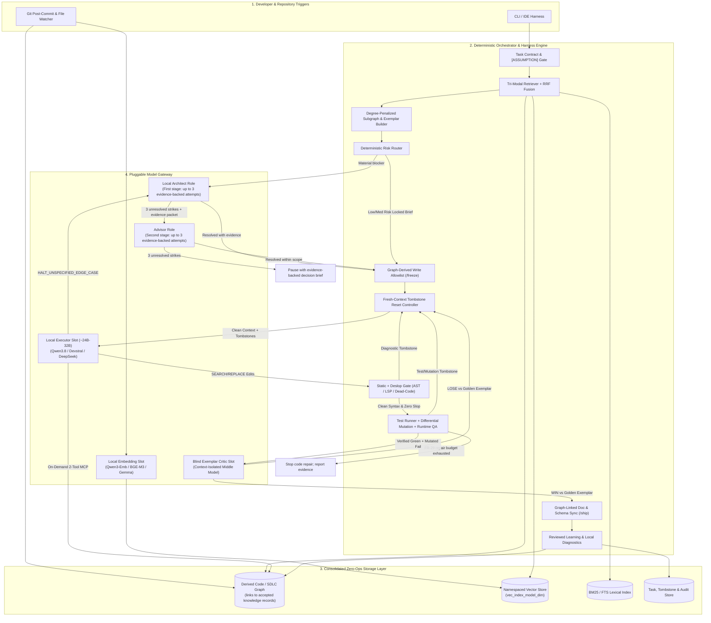
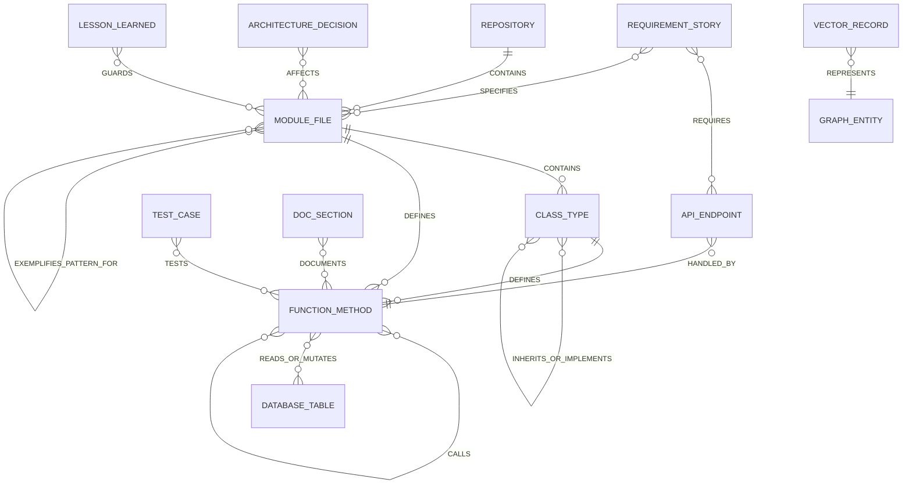
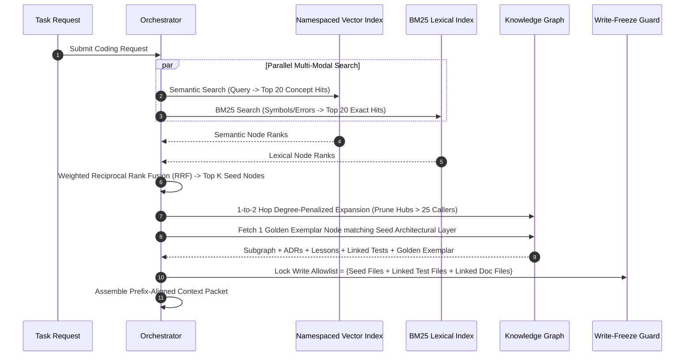
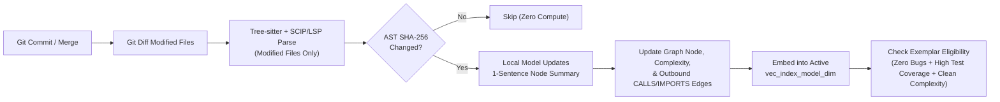

# Master System Architecture & Engineering Design Document (v1.0): Hybrid GraphRAG Multi-Model Coding Assistant

**Document Status:** Supplemental architecture proposal; non-normative and subordinate to the OneCode PRD, TRD, accepted ADRs, and agent operating rules.

This proposal's role names and diagrams are illustrative. In case of conflict, follow PRD FR-125 and TRD §4.3 for decision escalation, FR-29 for code-repair limits, and existing egress/approval policy. No external model or research call is implied or authorized by this document.

**Target System:** Autonomous Local-First Coding Orchestrator with Pluggable Model Gateway, GraphRAG Context Engine, and Multi-Stage Verification Harness

**Core Design Paradigm:** Tri-Modal GraphRAG + Pluggable Compute Slots + Fresh-Context Tombstone Loops + Subgraph Write-Freezing + Differential Mutation Testing + Blind Exemplar Critics

**Knowledge authority:** The second brain is the user-controlled lifecycle for capturing, reviewing, connecting, maintaining, recalling, and backing up project knowledge (PRD FR-126–FR-130). GraphRAG and the knowledge graph are derived indexes for navigation and retrieval, not sources of truth. Only accepted memory may be recalled as memory; drafts, inferred links, and generated summaries remain visibly distinct. Source code and project documents remain authoritative, and every resurfaced memory includes provenance and freshness. Portable backups are encrypted; restored records remain pending review until re-accepted.

---

## 1. Executive Summary & Architectural Philosophy


Autonomous coding systems face three compounding failure modes when transitioning from simple single-file edits to complex repository engineering:

1. **Context Starvation vs. Token Bloat:** Dumping an entire repository into a cloud frontier model is prohibitively expensive, while naive vector RAG misses structural dependencies (callers, interfaces, tests, and architectural invariants) required by local ~24B–32B models.
2. **Iterative Context Rot & Scope Drift:** When a local model fails a linter or test check and retries within the same conversation thread, broken diffs and stack traces pollute its attention window—causing hallucinated patches and accidental edits to unrelated shared modules.
3. **Reward Hacking & Soft Self-Critique:** Under pressure to make tests pass, coding models frequently weaken test assertions, write tautological unit tests, introduce defensive dead code ("AI slop"), or receive rubber-stamp approval (8/10 or 9/10 scores) from poorly isolated LLM reviewers.

This v1.0 architecture resolves all three failure classes by combining a **Tri-Modal Knowledge Graph** and **Pluggable Model Gateway** with hard deterministic engineering gates adapted from modern agentic harness paradigms (**`gstack`** sprint/freeze/deslop gates, **`gauntlet-loop`** blind pairwise exemplar comparison, **Ralph-style Fresh-Context Tombstone resets**, and **Differential Mutation Testing**).

### Six Pillars of the v1.0 Architecture

1. **Tri-Modal Retrieval with Golden Exemplars:** Fuses structural graph relationships (AST call graphs, requirements, architecture decisions, and links to user-accepted, source-linked lessons), semantic vector embeddings, and exact BM25 lexical matching—while retrieving a repository **Golden Exemplar Node** as a quality reference. Retrieval ranks evidence and accepted memory; it does not promote or establish truth.
2. **Model-Agnostic Compute Slots:** Decouples repository state from model weights. Any local ~24B–32B coding executor, local embedding model (isolated via automatic vector table namespacing), fast middle critic, or external frontier planner/reviewer can be hot-swapped via configuration.
3. **Locked Architecture Briefs & Subgraph Write-Freezing:** Enforces explicit `[ASSUMPTION]` tagging and a `HALT_UNSPECIFIED_EDGE_CASE` circuit breaker before coding begins, paired with a **Graph-Derived Write Allowlist** that physically blocks file edits outside the retrieved 2-hop subgraph.
4. **Fresh-Context Tombstone Execution Loop:** Eliminates multi-turn context rot by wiping the local executor's conversation history on every failed retry and restarting from a clean Context Packet plus a compact **Failed Attempt Tombstone**.
5. **Defense-in-Depth Verification & Anti-Slop Harness:** Chains an isolated Git Worktree sandbox, a sub-second **Static + Deslop Gate**, an automated **Unit + Runtime QA Runner**, and a **Differential Mutation Gate** that verifies newly written tests actually fail when the implementation logic is reverted.
6. **Context-Isolated Blind Exemplar Critic & Reviewed Learning:** Replaces vague 1–10 rubric grading with a blind side-by-side comparison (`WIN` vs. `LOSE`) against the repository's Golden Exemplar node; any reusable lesson remains a draft until reviewed and accepted under project policy.



---

## 2. Subsystem Layering & Pluggable Model Gateway

All model invocations pass through a **Unified Model Gateway** configured by architectural role rather than hardcoded model identifiers. Furthermore, the gateway enforces **Stage-Aware Micro-Prompt Injection**: rather than loading a monolithic 4,000-token system prompt containing every coding, testing, and review rule, the gateway injects only the 400–600 tokens of instructions relevant to the active state-machine node.

### 2.1 Pluggable Model Slot Matrix

| Architectural Role | Primary Responsibility | Pluggable Candidates | Hardware / API Profile | Gateway Adapter Enforcement |
| --- | --- | --- | --- | --- |
| **Local Embedding Slot** | Embeds code summaries, requirements, ADRs, and user-accepted, source-linked lessons | Qwen3-Embedding (0.6B/4B/8B), BGE-M3, EmbeddingGemma 2, Jina v4 | 1 GB–8 GB Local VRAM/RAM | Injects model-specific query prefixes; enforces Matryoshka dimension truncation; routes to isolated `vec_index_{model}_{dim}` table. |
| **Local Executor ("Junior Coder")** | Emits micro-plans with `[ASSUMPTION]` tags, edits code via `SEARCH/REPLACE`, writes mutation-proof tests | Qwen3.8-27B, Qwen3-Coder-32B, Devstral Small 2 (24B), DeepSeek-R1-Distill-32B | 24 GB VRAM or 32 GB Unified RAM | Overrides default context limits (`num_ctx`); strips internal `⟨think⟩` blocks; enforces `HALT_UNSPECIFIED_EDGE_CASE` tool availability. |
| **Blind Exemplar Critic ("Gauntlet Slot")** | Executes context-isolated side-by-side comparison (`WIN` vs `LOSE`) between candidate code and repo Golden Exemplar | Local Fast MoE (Qwen3-Coder-30B-A3B, GLM-4.7-Flash) or Cloud Flash (Gemini 3.8 Flash) | Local 24 GB RAM or Low-Cost Cloud API | Runs in a zero-history session; strips candidate/exemplar labels to prevent positional bias; enforces binary structured output. |
| **Local Architect** | Makes the first-stage, evidence-backed attempts to resolve material architectural or implementation blockers | User-configured local model role | Local runtime and its configured resource limits | Up to three distinct attempts; records criteria, evidence, and outcomes; cannot authorize policy-gated actions. |
| **Advisor** | Receives the Architect's evidence packet after three unresolved strikes; grounds its attempts in project docs and relevant research | User-configured advisor profile; external providers only when approved | Local by default; any external call follows existing egress approval | Up to three distinct attempts; cites project sources and records relevant authorized research; cannot grant permissions or mark checks passed. |

### 2.2 Stateless LLM Swapping vs. Stateful Embedding Isolation

```mermaid
flowchart LR
    subgraph StatelessLLMSwap["Stateless LLM Role Swap (Zero Downtime)"]
        RoleReq["Orchestrator State Request\n(Stage + Role)"]
        StagePrompt["Stage-Aware Micro-Prompt Loader\n(~500 Tokens Only)"]
        CapProfile["Model Capability Profile\n(Reads max_packet_tokens & num_ctx)"]
        Sanitizer["Output Sanitizer\n(Strips think tags & parses schemas)"]
        RoleReq --> StagePrompt --> CapProfile --> Sanitizer
    end

    subgraph StatefulEmbeddingSwap["Stateful Embedding Swap (Zero AST Re-Parsing)"]
        CanonicalNode["Knowledge Graph Node\n(Stores Raw Human-Readable Summary)"]
        ActiveEmb["Active Embedding Profile\n(Model Name + Dimension)"]
        TableRouter["Vector Namespace Router"]
        VecA[("vec_index_gemma_768")]
        VecB[("vec_index_qwen3_1024")]
        CanonicalNode --> TableRouter
        ActiveEmb --> TableRouter
        TableRouter -->|Profile A| VecA
        TableRouter -->|Profile B (Auto-Backfill)| VecB
    end

```

1. **Stateless LLM Hot-Swapping:**
* Changing the local executor or frontier reviewer in configuration takes effect on the very next orchestrator state transition—even mid-task.
* The Subgraph Builder dynamically adjusts the Context Packet token ceiling based on the active model's capability profile.
* All state (the Task Contract, Retrieved Context Packet, and Attempt Tombstones) resides in the orchestrator database rather than inside a model's chat session.


2. **Stateful Embedding Isolation:**
* Because every embedding model produces an incompatible vector coordinate space, vector tables are strictly namespaced by `vec_index_{model_slug}_{dimension}`.
* Graph nodes store canonical plain-text summaries, signatures, and snippets. Switching embedding models triggers a fast background batch job that reads those existing text summaries directly from the graph database and populates the new vector namespace without re-running Tree-sitter or LSP analysis.


---

## 3. Unified Storage & Extended Knowledge Graph Ontology

### 3.1 Consolidated Storage Architecture

To prevent multi-daemon synchronization failures across Git branch checkouts:

* **Local-First Embedded Deployment:** Combines **LadybugDB** (the maintained successor to KuzuDB; proposed in ADR-0017) for derived code-graph nodes and edges with **SQLite** for FTS5 BM25 keyword, relational task/tombstone data, and authoritative second-brain records, under the OS application-data directory and outside the target repository. `sqlite-vec` is optional and belongs only if ADR-0006 selects SQLite for vector search.
* **Server / Team Deployment:** Consolidates all four workloads into a **Single-Instance PostgreSQL** database utilizing Apache AGE (or recursive CTEs) for graph traversal, `pgvector` for namespaced embeddings, native `tsvector` for BM25 search, and standard relational tables for state tracking.
* **Branch-Safe Content Addressing:** Every node and vector record is keyed by `(symbol_qualified_name, ast_body_sha256)`. Checking out a different Git branch never requires re-indexing unchanged symbols; queries filter against the active Git tree's file hashes.

### 3.2 Extended Code/SDLC Graph Ontology and Reviewed-Memory References

In this supplemental proposal, the graph supports **Golden Exemplar benchmarking**, **Documentation-Drift detection**, and references to reviewed lessons. It is an index, not a canonical store for user-authored memory. Drafts remain in the capture/review inbox; accepted note content, provenance, revisions, and lifecycle state remain in the second-brain store described by PRD FR-126–FR-130 and TRD §§5.8 and 10.1–10.3. The graph may hold typed, provenance-bearing edges to accepted records, but never silently accepts or rewrites them.



### 3.3 Complete Node & Attribute Specification

| Node Category | Node Type | Key Stored Attributes | Role in v1.0 Harness |
| --- | --- | --- | --- |
| **Code Structure** | `Module / File` | `file_path`, `language`, `file_sha256`, `architectural_layer`, `is_golden_exemplar`, `quality_score` | Identifies module boundaries and marks curated **Golden Exemplar** reference files (`is_golden_exemplar = true`) per architectural layer. |
| **Code Structure** | `Class / Interface` | `qualified_name`, `file_path`, `line_range`, `docstring`, `summary`, `is_golden_exemplar` | Captures object hierarchy, type contracts, and class-level Golden Exemplars for the Gauntlet Critic. |
| **Code Structure** | `Function / Method` | `qualified_name`, `signature`, `signature_sha256`, `ast_body_sha256`, `summary`, `key_snippet`, `in_degree`, `out_degree`, `cyclomatic_complexity` | Tracks call degree (for God-node pruning), signature changes (for doc-drift sync), and complexity baselines (for the Deslop Gate). |
| **Data & Surface** | `API Endpoint` | `http_method`, `route_pattern`, `request_schema`, `response_schema`, `smoke_test_url` | Triggers the headless Runtime Smoke QA Gate whenever an endpoint or its handler is modified. |
| **Data & Surface** | `Database Table` | `table_name`, `column_definitions`, `migration_file`, `orm_model_ref` | Elevates Risk Router score when schema mutations or non-transactional queries are detected. |
| **Verification** | `Test Case` | `test_name`, `file_path`, `test_ast_sha256`, `target_symbols`, `last_mutation_score` | Enables targeted test execution and protects existing assertions via `test_ast_sha256`. |
| **SDLC & Docs** | `Requirement` | `req_id`, `title`, `acceptance_criteria`, `edge_case_constraints` | Anchors the `TaskContract` and flags unspecified edge cases during execution. |
| **SDLC & Docs** | `Architecture Decision` | `adr_id`, `title`, `invariants`, `forbidden_patterns` | Injected into the immutable prompt prefix to enforce system-wide architectural rules. |
| **SDLC & Docs** | `Doc Section` | `doc_path`, `heading_anchor`, `documented_symbols`, `last_synced_signature_sha256` | Enables automatic **Doc-Drift Sync** when a linked function's `signature_sha256` changes. |
| **Reviewed knowledge reference** | `Accepted lesson` | `record_id`, `source_task_id`, `relation_type`, `source_revision`, `freshness` | May be retrieved for applicable tasks with provenance and freshness; only an accepted record is eligible, and it remains context rather than proof or authorization. |

---

## 4. Tri-Modal Retrieval, Exemplar Selection & Write-Scope Freezing

When a task enters the orchestrator, retrieval accomplishes two goals simultaneously: assembling a **bounded, high-signal Context Packet** and defining the **strict physical boundary of files the local executor is allowed to touch**.



### 4.1 Weighted Reciprocal Rank Fusion & Degree-Penalized Expansion

1. **Tri-Modal Seed Selection:** Vector ranks ($r_{\text{vec}}$) and BM25 lexical ranks ($r_{\text{lex}}$) are merged using Weighted Reciprocal Rank Fusion:

$$\text{RRF\_Score}(n) = \frac{1.0}{60 + r_{\text{vec}}(n)} + \frac{1.2}{60 + r_{\text{lex}}(n)}$$


2. **God-Node Pruning:** During 1-to-2 hop graph expansion from the top seed nodes, any utility node with `in_degree > 25` has its inbound callers pruned so shared utilities (`Logger`, `Config`, `BaseException`) never flood the context window.
3. **Automatic Golden Exemplar Retrieval:** Every `Module / File` belongs to an `architectural_layer` (e.g., `service`, `repository`, `api_route`, `domain_model`, `test_suite`). During graph expansion, the retriever queries the graph for **one node** where `is_golden_exemplar = true` in the same `architectural_layer` as the primary seed node. This exemplar is stored in the Task Record for both style grounding and the downstream Gauntlet Critic.

### 4.2 Graph-Derived Write-Scope Freezing (`/freeze` Principle)

Inspired by `gstack`'s `/freeze` boundary control, the orchestrator eliminates accidental cross-module edits deterministically:

* Upon completing subgraph expansion, the orchestrator computes an immutable **Write Allowlist** consisting solely of:
1. File paths of the top Seed Nodes.
2. File paths of directly linked `Test Case` nodes (or designated new test paths).
3. File paths of directly linked `Doc Section` / OpenAPI schema nodes.


* Any `SEARCH/REPLACE` block emitted by the local 32B executor targeting a file outside this allowlist is rejected immediately at the file-applier boundary before touching disk.
* If the local executor genuinely needs to modify an external file, it must emit a structured `REQUEST_SCOPE_EXPANSION(file_path, reason)` signal, which re-runs the Risk Router to validate the expanded blast radius.

---

## 5. Pre-Coding Specification Gate & Deterministic Risk Router

### 5.1 Locked Architecture Brief & `[ASSUMPTION]` Gating

Before writing code, the orchestrator prevents the local 32B executor from guessing on ambiguous requirements:

1. **Micro-Plan & `[ASSUMPTION]` Extraction:** On every task, the local executor or local Architect role outputs a structured **Task Contract & Micro-Plan** listing target symbols, data-flow changes, and explicit `[ASSUMPTION: ...]` tags for any behavior not explicitly specified in the `Requirement` or `Architecture Decision` nodes.
2. **Automated Assumption Audit:** The orchestrator parses all `[ASSUMPTION]` tags:
* If zero assumptions exist, or if assumptions only touch low-risk local implementation details, the brief is **Locked** and execution begins.
* If any `[ASSUMPTION]` touches a high-risk node (authentication, billing, database schema, or public API contract), the orchestrator blocks implementation until the required user/policy decisions are satisfied. If the material blocker remains unresolved, use FR-125's local Architect stage first; do not make an external call or bypass a required approval.


3. **Mid-Execution Stop-on-Ambiguity (`HALT_UNSPECIFIED_EDGE_CASE`):** During coding, if the local executor discovers an undocumented caller constraint or contradictory type contract via its on-demand MCP lookup, it is instructed to emit `HALT_UNSPECIFIED_EDGE_CASE` rather than improvise a workaround.

### 5.2 Deterministic Risk Scoring Matrix

| Risk Factor | Graph / Static Inspection Condition | Score Weight | Orchestrator Routing Impact |
| --- | --- | --- | --- |
| **High Blast Radius** | Target seed symbol has 2-hop transitive caller count (`in_degree`) greater than 10 | **+3** | Increases scrutiny and requires scoped independent review; any unresolved material decision follows FR-125. |
| **Critical Security Path** | Target file path matches `auth/`, `security/`, `crypto/`, `billing/`, or `permissions/` | **+3** | Requires applicable policy gates and scoped independent review; any unresolved material decision follows FR-125. |
| **High-Risk `[ASSUMPTION]**` | Initial micro-plan contains an unverified `[ASSUMPTION]` on data schema or API contract | **+3** | Blocks affected implementation until resolved; unresolved decision follows FR-125 and required approvals remain immediate. |
| **Schema / Contract Mutation** | Subgraph includes a `Database Table` migration or breaking `API Endpoint` change | **+2** | Triggers schema compatibility check and Runtime Smoke QA. |
| **Architectural Governance** | Target module is governed by an active `Architecture Decision` node | **+2** | Injects ADR invariants into both Static Gate and Gauntlet Critic. |
| **Verification Blind Spot** | Target `Function` has zero incoming `TESTS` edges in the Knowledge Graph | **+1** | Forces mandatory new unit test creation + Differential Mutation check. |

* **Score 0–1 (Low Risk):** Local 32B Executor implements inside worktree → Static + Deslop Gate → Unit Tests + Differential Mutation Check → Merge.
* **Score 2–4 (Medium Risk):** Adds **Gauntlet Blind Exemplar Critic** comparison + **Runtime Smoke QA** before merge.
* **Score 5+ (High Risk):** Adds scoped review and verification gates. Risk score does not skip FR-125's local Architect → Advisor sequence for an unresolved material decision, and does not replace required user approvals.

---

## 6. Fresh-Context Tombstone Loop & Defense-in-Depth Verification Harness

This section defines the core runtime loop that keeps a local ~24B–32B model performing at near-frontier reliability without context degradation.

```mermaid
stateDiagram-v2
    [*] --> BriefLocked: Task Contract + Write Allowlist Locked
    BriefLocked --> FreshContextInit: Initialize separate FR-29 code-repair counter

    state FreshContextTombstoneLoop {
        FreshContextInit --> LocalExecute: Assemble Clean Prompt\n(Context Packet + Locked Brief + Compact Tombstones Only)
        LocalExecute --> ScopeGuard: Emit SEARCH/REPLACE Blocks
        ScopeGuard --> RecordTombstone: File Outside Write Allowlist
        ScopeGuard --> StaticDeslopGate: Allowlist Valid

        StaticDeslopGate --> RecordTombstone: AST Error / Linter Fail / Slop Detected
        StaticDeslopGate --> UnitAndSmokeTests: Clean Syntax, Types & Complexity

        UnitAndSmokeTests --> RecordTombstone: Unit Test or Playwright/API Smoke Fail
        UnitAndSmokeTests --> DifferentialMutationGate: All Tests Green

        DifferentialMutationGate --> RecordTombstone: New Test Still Passes When Code Reverted (Fake Test!)
        DifferentialMutationGate --> GauntletBlindCritic: New Test Fails When Code Reverted (Genuine Test!)

        GauntletBlindCritic --> RecordTombstone: Candidate LOSES vs Repo Golden Exemplar
    }

    RecordTombstone --> WipeChatHistory: Compress Failure to 3-Line Tombstone & Wipe LLM Thread
    WipeChatHistory --> FreshContextInit: New evidence and below configured FR-29 repair limit
    WipeChatHistory --> RepairBlocked: Repair limit reached or same failure repeats without new evidence
    LocalExecute --> DecisionEscalation: Emits HALT_UNSPECIFIED_EDGE_CASE or identifies material blocker
    DecisionEscalation --> ArchitectStage: Up to 3 distinct evidence-backed local attempts
    ArchitectStage --> AdvisorStage: 3 unresolved Architect strikes; include complete attempt evidence
    AdvisorStage --> AdvisorStage: Up to 3 distinct attempts grounded in project docs and permitted research
    AdvisorStage --> HumanDecision: 3 unresolved Advisor strikes; pause with decision brief
    ArchitectStage --> FreshContextInit: Blocker resolved with evidence
    AdvisorStage --> FreshContextInit: Blocker resolved within scope
    GauntletBlindCritic --> GraphDocSync: Candidate WINS vs Golden Exemplar
    GraphDocSync --> ReviewLearning: Draft any reusable lesson for review
    ReviewLearning --> [*]: Approved under project policy

```



### 6.1 The Fresh-Context Tombstone Reset Loop (Eliminating Context Rot)

Standard coding agents append compiler errors, failed diffs, and test stack traces into a growing multi-turn conversation. By turn 3, a local 32B model's attention is degraded by contradictory prior attempts.

The orchestrator enforces a strict **Stateless Retry Protocol** (adapted from the Ralph Loop pattern):

1. **Complete Thread Wipe on Failure:** Whenever any verification gate fails (Scope Guard, Static/Deslop Gate, Unit Test, Mutation Gate, or Gauntlet Critic), the orchestrator immediately **destroys** the local executor's conversation thread and rolls back the uncommitted file edits in the sandbox worktree (or snapshots the failed diff in the audit store).
2. **Tombstone Compression:** A deterministic extractor compresses the failure into a structured, 3-to-4 line **Attempt Tombstone**:
* *Attempt #:* 1
* *Gate Failed:* `StaticDeslopGate` (or `UnitAndSmokeTests` / `GauntletBlindCritic`)
* *What Was Tried:* Modified `AuthService.link_oauth` to query user by email without transaction lock.
* *Exact Failure Diagnostic:* `mypy error line 84: Optional[User] has no attribute id` (or exact failing test assertion).


3. **Clean Re-Invocation:** On Attempt #2, the local 32B model is called in a **brand-new, zero-history session** containing only:
* The Stage-Aware Micro-Prompt (~500 tokens).
* The original Prefix-Aligned Context Packet.
* The Locked Architecture Brief.
* The compact `Attempt Tombstone` block (under 150 tokens) instructing the model not to repeat that specific failure path.


### 6.2 Gate 1: Surgical Edit Application & Sub-Second Static + Deslop Gate

Immediately after the local executor emits `SEARCH/REPLACE` blocks inside the isolated Git worktree:

1. **Three-Tier Fuzzy Applier:** Applies the edit via exact match, whitespace-normalized match, or AST symbol-boundary replacement, then generates a clean programmatic `git diff`.
2. **Compiler & Typecheck Pass:** Executes sub-second incremental checks (`Tree-sitter` ERROR node scan, `ruff` + `pyright`, `biome` + `tsc --noEmit`, or `cargo check`).
3. **Automated "Deslop" Pass (`gstack` Principle):** Inspects the AST diff between the original symbol and the modified symbol for common AI anti-patterns:
* **Unreferenced Dead Code:** Flags newly added helper functions, variables, or imports with zero callers (`vulture` / `knip`).
* **Swallowed Exceptions:** Flags newly introduced bare `except:` or empty `catch (e) {}` blocks that silence runtime errors without logging or re-raising.
* **Complexity Spike:** Flags functions whose cyclomatic complexity increased by more than a configurable delta without corresponding branch requirements in the Task Contract.
* **Comment Slop:** Strips restating inline comments (e.g., `# increment counter by 1`) via AST comment filtering.


### 6.3 Gate 2: Unit Test Suite & Runtime Smoke QA (`/qa` Principle)

Once the Static + Deslop Gate passes:

1. **Graph-Targeted Unit & Integration Tests:** The test runner executes all `Test Case` nodes connected via `TESTS` edges within 2 hops of the modified symbols, plus any newly created tests.
2. **Existing Assertion Protection:** The Git diff manager compares the AST of existing `Test Case` nodes against their stored `test_ast_sha256`. If an existing assertion was deleted or weakened without explicit authorization in the Task Contract, the run fails immediately.
3. **Live Runtime Smoke Gate:** If the retrieved subgraph contains an `API Endpoint` or UI component node, the sandbox container boots the application server and executes either:
* An **OpenAPI / HTTP Contract Probe** verifying status codes, response schemas, and zero `500` server errors on the affected routes.
* A **Headless Playwright Browser Probe** verifying the page renders with zero uncaught console exceptions or network failures.


### 6.4 Gate 3: Differential Mutation Testing (True Anti-Reward-Hacking)

To guarantee that new unit tests written by the local 32B executor actually verify the new business logic rather than asserting tautologies:

1. After the new implementation and new tests pass Gate 2, the orchestrator temporarily **stashes only the implementation file changes** (reverting `src/` to `HEAD`) while keeping the newly added test changes in `tests/`.
2. It executes **only the newly added test cases** against the unedited base implementation (or against a single-line AST operator mutation in the target function if testing a pure bug fix):
* **Expected Outcome:** The new test **MUST FAIL** when the implementation code is absent or mutated.
* **Reward-Hacking Caught:** If the new test **passes** even when the implementation changes are reverted, the test is tautological/fake. The orchestrator rejects the test, creates a `DifferentialMutationGate` Tombstone, and triggers a Fresh-Context retry.


### 6.5 Gate 4: The Gauntlet Blind Exemplar Critic (`gauntlet-loop` Principle)

To eliminate LLM score inflation ("This code looks solid, 8.5/10"), Medium- and High-risk tasks must pass a **Context-Isolated Blind Pairwise Comparison** before merge:

1. **Zero-History Critic Session:** The orchestrator invokes the configured independent reviewer in a completely isolated session. Any external model call remains subject to egress approval. The critic is given **zero information** about how many retries the local model took or how difficult the task was.
2. **Label-Stripped Side-by-Side Presentation:** The orchestrator presents two code artifacts from the same `architectural_layer`:
* **Artifact Alpha:** The repository's curated **Golden Exemplar Node** retrieved in Stage 4.1 (or randomized as Beta to eliminate order bias).
* **Artifact Beta:** The newly modified function/class produced by the local executor, along with the active `Architecture Decision` invariants.


3. **Mandatory Binary Verdict (`WIN` / `LOSE`):** The critic is forbidden from outputting numerical scores. It must evaluate whether the candidate artifact matches or exceeds the Golden Exemplar's standards across four structural axes:
* *Error & Transaction Handling*
* *Type Safety & Boundary Validation*
* *Idiom & Naming Consistency with the Exemplar*
* *Absence of Defensive Redundancy*


4. If the critic outputs `LOSE`, its specific structural deficiency list is compressed into an `Attempt Tombstone` for a Fresh-Context code-repair retry, subject to the separate FR-29 budget and repeated-failure stop.

### 6.6 Gate 5: Graph-Linked Documentation & Schema Sync (`/ship` Principle)

Once all code and critic gates pass:

* The orchestrator compares the post-edit `signature_sha256` and behavior summary of modified `Function` and `API Endpoint` nodes against their pre-edit values.
* If a public signature, route parameter, or behavior contract changed, the orchestrator follows outbound `DOCUMENTS` and `SPECIFIES` edges in the Knowledge Graph to locate the exact Markdown sections (`README.md`, `ARCHITECTURE.md`) or OpenAPI specs affected, and runs a bounded doc-sync pass inside the same worktree before finalizing the branch.

---

## 7. Three-Strike Decision Escalation & Reviewed Learning

The decision-escalation path applies to material architectural or implementation blockers, not routine choices or code-check retries. It follows FR-125 and TRD §4.3:

1. The local Architect receives the blocker, acceptance criteria, relevant project context, and up to three distinct opportunities to produce an evidence-backed resolution. A failed criterion or the same blocker remaining unresolved counts as a strike; repeated turns and tool calls do not.
2. After three unresolved Architect strikes, the Advisor receives the original request, blocker, criteria, evidence, and all prior approaches/outcomes. It makes up to three distinct evidence-backed attempts. Every attempt consults relevant project instructions, PRD/TRD/ADRs, local source/tests, and other project references; it identifies and researches comparable projects and authoritative technical sources when relevant and permitted.
3. External research is allowed only under existing egress approval. Citations must resolve to gateway-produced `ResearchEvidence` artifacts with canonical source, retrieval time, source revision/date where available, content hash, cited span, and approval receipt; a model-supplied URL or failed fetch is not evidence. If unavailable or unauthorized, record that fact and do not imply research occurred.
4. After three unresolved Advisor strikes, pause and present the user with the blocker, criteria, evidence, attempted approaches and outcomes, project-document citations, any permitted research, remaining options, and a recommended question. Do not keep prompting at each intermediate action.
5. Architect/Advisor counters are scoped to a core-generated durable `BlockerEpisode` and `root_blocker_id` and remain independent of FR-29's configurable code-repair budget. The core preserves identity across relabeling, turns, sessions, and model changes; it may create a linked episode only after a user-confirmed material scope/criteria change or a distinct acceptance criterion/diagnostic fingerprint with separate affected scope. Agents cannot create IDs or request resets; when evidence does not establish a distinct root, retain the existing root and counters. Hard-policy approvals, required user decisions, and interrupts remain immediate.
6. A reusable learning may be proposed from a verified outcome, but it remains a draft until user-reviewed and accepted under project policy; no agent automatically writes policy, permissions, or permanent lessons.


---

## 8. Incremental Indexing & Golden Exemplar Curation Pipeline



1. **Sub-2-Second Post-Commit Delta Indexing:** Only files modified in `git diff HEAD~1..HEAD` are parsed. Unchanged functions within a modified file are skipped via `ast_body_sha256` comparison.
2. **Automated + Manual Golden Exemplar Curation:**
* Developers can explicitly tag reference files via CLI or repo config (`orchestrator exemplar mark src/auth/service.py`).
* Additionally, the indexer automatically recommends candidate Golden Exemplars by identifying modules with high test coverage (`TESTS` edges), low cyclomatic complexity, zero recent bug/rollback history, and clean static analysis scores.


---

## 9. Phased Implementation Roadmap & Benchmark Telemetry

### 9.1 Three-Phase Engineering Rollout

| Phase | Milestone Scope | Core Deliverables |
| --- | --- | --- |
| **Phase 1: Foundation & Pluggable Gateway (Weeks 1–3)** | Storage, Indexing, and Model Abstraction | SQLite relational/FTS store plus LadybugDB graph store (proposed in ADR-0017; PostgreSQL remains a separate server/team alternative); incremental Tree-sitter + LSP/SCIP indexer; Pluggable Model Gateway with dynamic `vec_index_{model}_{dim}` namespacing; isolated Git worktree runner and fuzzy `SEARCH/REPLACE` applier. |
| **Phase 2: GraphRAG, Fresh-Context Loop & Static/Mutation Gates (Weeks 4–6)** | Retrieval, Risk Routing, and Execution Harness | Weighted RRF + Degree-Penalized Subgraph Builder; Graph-Derived Write Allowlist (`/freeze`); `[ASSUMPTION]` & `HALT_UNSPECIFIED_EDGE_CASE` gate; Fresh-Context Tombstone Reset controller; Static + Deslop Gate; Unit Test + Differential Mutation Gate. |
| **Phase 3: Gauntlet Critic, Advisor Escalation & Reviewed Learning (Weeks 7–8)** | Quality Benchmarking and Decision Escalation | Golden Exemplar graph tagging + Context-Isolated Blind Pairwise Critic (`gauntlet-loop`); FR-125 three-Architect/three-Advisor escalation with source-grounded handoff packet; Runtime Playwright/API Smoke QA; Graph-Linked Doc Sync (`/ship`); user-reviewed learning drafts. |

### 9.2 Production Evaluation & Telemetry Metrics

| Evaluation Dimension | Metric Definition | Target Production Bar | Architectural Mechanism Validated |
| --- | --- | --- | --- |
| **Architect Resolution Rate** | Percentage of material blockers resolved within the three-attempt local Architect stage | **Measure baseline before setting target** | Validates project context quality and first-stage recovery. |
| **Advisor Resolution Rate** | Percentage of escalated blockers resolved within the Advisor's separate three-attempt stage | **Measure baseline before setting target** | Validates project-grounded Advisor guidance and source research under egress policy. |
| **Retry Recovery Efficiency** | Percentage of tasks that fail Attempt #1 but pass Attempt #2 after a Fresh-Context Tombstone reset | **> 60% of Attempt #1 failures** | Validates that wiping chat history and injecting compact Tombstones prevents context rot. |
| **Test Integrity Score** | Differential Mutation Kill Rate (Percentage of agent-written tests that fail when implementation changes are stashed) | **100% (Hard Gate)** | Guarantees zero tautological or fake unit tests enter the repository. |
| **Scope Containment** | Unapproved Out-of-Subgraph File Modifications | **0% (Hard Gate)** | Validates the Graph-Derived Write Allowlist (`/freeze`). |
| **Critic Discrimination** | Gauntlet Blind Exemplar Pass Rate on first attempt vs. post-refinement | **Catches 100% of style/idiom drift without score inflation** | Validates blind pairwise comparison against repository Golden Exemplars. |
| **Compounding Intelligence** | Repeated-blocker rate on modules with user-approved, source-linked learning notes | **Measure baseline before setting target** | Validates that reviewed project learnings help avoid previously resolved blockers. |