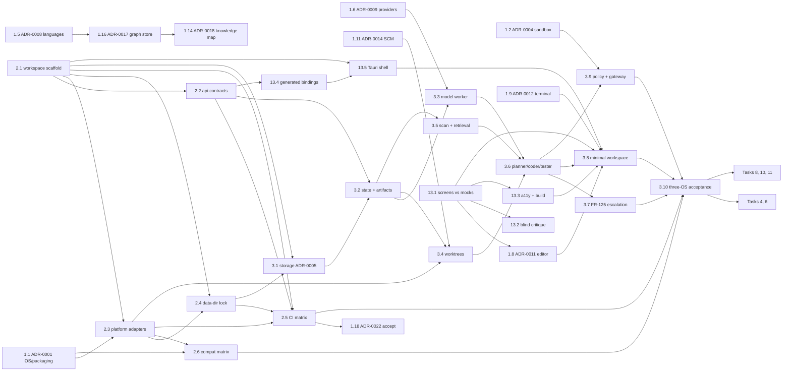

# OneCode Implementation Plan

## Overview

This is the implementation roadmap for OneCode, a local-first coding application. Product behavior and acceptance detail remain in the [PRD](../docs/PRD.md); component boundaries, workflows, and test strategy remain in the [TRD](../docs/TRD.md).

Phases 0 and 1 are decomposed into small, independently verifiable slices (`Task N.M`) with explicit backward and forward dependency edges, because they are the work that can start now. Phases 2 to 5 stay epic-level; decompose each into slices before coding it, and resolve its referenced open decisions first. The [dependency graph](#dependency-graph) below is the authoritative ordering.

Epic numbers Task 1 to Task 13 are stable and are never renumbered, because the [ADR index](../docs/adr/README.md) cites them in its "Blocks" column. Slices take sub-IDs under their epic.

The target initial release supports Windows, macOS, and Linux, including the same core coding workflow and initial-release local-model capabilities. A platform limitation must be explicit and must not weaken security guarantees.

## Architecture and sequencing decisions

### Decided baseline

These are accepted ADRs, not open questions. Slices implement them; they do not re-decide them.

- **Process and crate layout — [ADR-0002](../docs/adr/0002-process-model.md).** One core process per data directory, holding an exclusive OS file lock; a second host refuses to start and names the running one. Untrusted and crash-prone code is always out of process: commands, tests, hooks, MCP servers, language servers, the browser engine, and the model runtime in a supervised `onecode-model-worker`. One Cargo workspace at the repository root, crates under `crates/onecode-<component>`, the Tauri shell at `apps/desktop/src-tauri` (package `onecode-desktop`), and `desktop`/`cli` depending only on `onecode-api`.
- **Desktop UI and bridge — [ADR-0003](../docs/adr/0003-desktop-ui-and-bridge.md).** Tauri 2 with React/TypeScript, versioned Rust API contracts over Tauri commands and channels, no TCP listener.
- **Storage — [ADR-0005](../docs/adr/0005-storage-engine.md).** SQLite through rusqlite in three stores under the OS application-data directory, never in the target repository: SQLCipher-encrypted `state/state.db`, unencrypted rebuildable `index/<repository-id>.db`, and per-file XChaCha20-Poly1305 `artifacts/<sha256>`. State key in the OS credential store via `keyring`, with an Argon2id passphrase fallback and no unencrypted fallback. Forward-only migrations with an encrypted pre-migration backup.
- **Contracts — [ADR-0020](../docs/adr/0020-contract-casing-and-bindings.md).** camelCase JSON, `schemaVersion`, internally tagged unions with kebab-case `kind`, TypeScript bindings generated by ts-rs into `apps/desktop/src/api/generated/`, JSON Schemas in `schemas/` with golden tests, and a CI check that fails if regeneration diffs. SQL stays `snake_case`.
- **Release identity — [ADR-0022](../docs/adr/0022-central-version-source.md) (Proposed, already implemented).** Root `VERSION` is the single source; manifests carry generated mirrors; `node scripts/sync-version.mjs --check` gates each package build. Public schema versions evolve independently of `VERSION`.

Still **Proposed** and needing acceptance before their consumers start: [ADR-0017](../docs/adr/0017-code-knowledge-graph-store.md) (LadybugDB graph store), [ADR-0021](../docs/adr/0021-encrypt-portable-knowledge-backups.md) (encrypted portable backups), ADR-0022.

### Sequencing

- Follow the four proposed delivery milestones in [TRD §16](../docs/TRD.md#16-proposed-implementation-milestones): verified vertical slice, repository intelligence, governed agency, and productization.
- **Resolve ADRs just-in-time per phase, not all up front.** Only ADR-0001, ADR-0004, ADR-0012, and the acceptance of ADR-0017 gate Phase 1. The rest are scheduled immediately before the phase that consumes them, so a decision is made when its evidence is freshest and its constraints are understood.
- Keep shared task, repository, model, and policy behavior platform-neutral; use narrow OS adapters as described in [TRD §3.3](../docs/TRD.md#33-cross-platform-architecture).
- Prefer maintained open-source libraries for commodity capabilities; resolve the library-versus-custom decision in the owning ADR and keep OneCode-specific policy, semantics, contracts, and trust boundaries in OneCode code. The [tech-stack inventory](../docs/TECH-STACK.md) is a dated candidate list, not an approved manifest.
- Preserve non-embedding search when local models are absent. Embeddings augment retrieval; they do not replace the task router or permission gateway.
- Make security, privacy, isolation, traceability, and native OS validation release gates, not deferred polish.
- Record the remaining open choices listed in [TRD §17](../docs/TRD.md#17-open-technical-decisions) as ADRs; the reserved numbers are in the [ADR index](../docs/adr/README.md).
- Treat the workspace surfaces (editor, terminal, browser with annotations, source control, process registry) as initial-release scope per [PRD §10.11](../docs/PRD.md#1011-workspace-surfaces-editor-terminal-browser-and-source-control) and [TRD §3.4](../docs/TRD.md#34-workspace-services); land their minimal forms inside the vertical slice and complete them in Tasks 10 and 11.
- The desktop UI already exists as a React app on a development fixture adapter. Task 13 tracks it as a first-class delivery stream that feeds the vertical slice, rather than leaving it as untracked work-in-progress.
- Apply the [engineering standards](../docs/ENGINEERING-STANDARDS.md) to every task, including the verification-economy and single-instance rules, and trace each task to `FR-nn` IDs and agent rules `R-nn`.

## Task List

### Phase 0: Resolve release contracts

#### Task 1: Resolving architecture and support decisions

**Description:** Resolve the choices that are still open and determine cross-platform implementation and security boundaries. Record alternatives, decision rationale, compatibility constraints, and revisit triggers using [0000-template.md](../docs/adr/0000-template.md). Four decisions are already accepted (ADR-0002, 0003, 0005, 0020) and are implemented by Phase 1 slices rather than re-decided here.

**Acceptance criteria:**
- [ ] Minimum supported Windows, macOS, and Linux versions, packaging, signing/notarization, and the update channel are recorded (ADR-0001).
- [ ] Every remaining open choice in [TRD §17](../docs/TRD.md#17-open-technical-decisions) has either an accepted ADR or a bounded proposal with a named owner and a release-blocking status.
- [ ] Offline model-bundle format, signed-manifest trust root and key lifecycle, and failure handling are defined without requiring network access at import time (ADR-0007).
- [ ] Any capability that cannot meet the security bar on a supported OS is specified to fail closed, with its user-visible limitation documented.
- [ ] Each high-impact commodity subsystem has an ADR-backed library-versus-custom decision recording candidates, current versions, license/security/maintenance/MSRV review, performance and accessibility evidence, and a migration or revisit trigger.
- [ ] ADR-0017, ADR-0021, and ADR-0022 move from Proposed to Accepted, or are revised with the reason recorded.

**Verification:** Review the ADR set against PRD §§10.9–10.10 and 15, FR-64–FR-65, and TRD §§3.3–3.4.7, 7.1.2, and 17. Confirm every open decision has an owner and a recorded reuse evaluation, and run `node scripts/check-doc-links.mjs` so each new ADR resolves from the [ADR index](../docs/adr/README.md).

**Dependencies:** None.

**Files likely touched:** `docs/adr/*.md`, `docs/adr/README.md`, and linked PRD/TRD updates where a decision changes behavior or architecture.

**Estimated scope:** Large epic, decomposed below into 18 single-decision slices.

##### Phase 0 slices

Every slice below shares these acceptance criteria and verification steps; only the slice-specific evidence is listed in the table.

- The ADR follows [0000-template.md](../docs/adr/0000-template.md): status, date, deciders, affected `FR-nn` / `TRD §n.n` / `R-nn` IDs, and a revisit trigger.
- A maintained library is evaluated against a custom implementation per [dependency policy §1](../docs/DEPENDENCY-POLICY.md), recording version, license, maintenance, MSRV, platform support, and binary payload. Versions obey the 14-day cool-down in [dependency policy §4](../docs/DEPENDENCY-POLICY.md#4-latest-safe-versions).
- Any new trust boundary or dependency with system reach carries a threat-model section ([engineering standards §4](../docs/ENGINEERING-STANDARDS.md#4-security-engineering)): assets, entry points, trust levels, abuse cases, mitigations, tests.
- The [ADR index](../docs/adr/README.md) row is added or annotated in the same change, and `node scripts/check-doc-links.mjs` exits 0.
- A capability an OS cannot provide is specified to fail closed with a typed `Unsupported` result, never a silent weaker fallback.

| Slice | ADR | Decision to record | Depends on | Blocks |
|---|---|---|---|---|
| **1.1** | 0001 | Minimum supported OS versions, packaging and installers, signing/notarization, update channel, model acquisition, license/commercial model | — | 1.3, 1.6, 1.9, 1.10, 1.12, **2.3**, **2.6**, Task 9 |
| **1.2** | 0004 | Sandbox strategy and per-OS isolation guarantees, including WSL as a distinct target (FR-81) | — | **3.9**, Task 6, Task 7 |
| **1.3** | 0006 | Default bundled embedding model (redistribution license, size, hardware floor, per-OS runtime), curated catalog and format policy, vector storage engine, index migration | 1.1 | 1.4, Task 5 |
| **1.4** | 0007 | Offline model-bundle container and signature formats, trusted-key rotation/revocation, air-gapped trust-metadata refresh | 1.3 | Task 5 |
| **1.5** | 0008 | First language and framework support matrix; tree-sitter grammar set and parser coverage/provenance | — | 1.16, Task 4 |
| **1.6** | 0009 | Frontier provider APIs versus an OpenAI-compatible proxy abstraction; provider adapter contract | 1.1 | 3.3, Task 6 |
| **1.7** | 0010 | Skill packaging, plugin ABI, and compatibility guarantees | — | Task 6 |
| **1.8** | 0011 | Editor engine (Monaco versus CodeMirror) and the versioned document-model bridge; keystroke, large-file, accessibility, and bridge benchmarks | 13.1 | 3.8, Task 10 |
| **1.9** | 0012 | Terminal emulator and PTY implementation per OS (ConPTY, forkpty, WSL interop), including WSL behavior | 1.1 | **3.8**, Task 10 |
| **1.10** | 0013 | Built-in browser engine (platform WebView versus bundled Chromium with DevTools protocol) and the element-to-source mapping sources | 1.1 | Task 10 |
| **1.11** | 0014 | Source-control implementation (Git CLI versus embedded library) and credential-helper handling that never reads credential contents into model context | — | 3.4, Task 10 |
| **1.12** | 0015 | Language-server distribution and trust model; debugger-adapter scope | 1.1 | Task 10 |
| **1.13** | 0016 | Hook, rule, and custom-command definition formats and compatibility with other agent tools' formats | — | Task 11 |
| **1.14** | 0018 | Knowledge-map rendering engine and layout for large graphs, linked-note storage format, Markdown/wikilink export compatibility | 1.16 | v1.5 (FR-119, FR-120) |
| **1.15** | 0019 | OpenTelemetry-compatible instrumentation and export protocol, allowed data and destinations, retention, egress threat model | — | Task 9, only if export is enabled |
| **1.16** | 0017 | Accept or revise LadybugDB as the graph store; then graph schema versioning, community-detection algorithm, repository-map ranking | 1.5 | 1.14, Task 4 |
| **1.17** | 0021 | Accept or revise encrypted portable knowledge backups and the re-review rule for restored records | — | v1.5 (FR-130), Task 12 |
| **1.18** | 0022 | Accept the root `VERSION` source of truth, already implemented, and wire `sync-version.mjs --check` as a required CI gate | 2.5 | Task 9 |

Slice-specific evidence required before a slice is Accepted:

- **1.1** — a versioned compatibility matrix of OS versions, package status, and per-OS security capabilities; the release exception process and its approver are named.
- **1.2** — per-OS proof that a sandboxed process cannot write protected paths, reach the network when denied, or read credentials; the WSL path is verified separately and never presented as native Windows.
- **1.8 / 1.9 / 1.10 / 1.13** — measured benchmarks against the PRD §12 budgets (editor keystroke p95 < 16 ms to 10,000 lines; terminal 10 MB/s sustained; annotation-to-task < 5 s) plus accessibility evidence, not vendor claims.
- **1.16** — native `lbug` build and graph read/write tests on all three OSes, graph queries and re-index work measured against the [engineering standards §12](../docs/ENGINEERING-STANDARDS.md#12-performance-and-resource-budgets) budgets, and symlink-containment evidence for the mid-open race in its threat model. Pinned at `lbug` 0.21.1 while 0.22.1 is inside the cool-down. If the containment evidence is absent, the ADR stays Proposed and SQLite graph tables remain the store.
- **1.18** — `node scripts/sync-version.mjs --check` runs in CI and fails on drift; the release checklist adds "tag matches `VERSION`".

**Checkpoint — Phase 0 critical path:** 1.1, 1.2, 1.9, and 1.16 are accepted or have bounded proposals before Phase 1 coding starts past slice 2.2. The remaining slices are scheduled just-in-time and do not block the workspace scaffold.

### Phase 1: Cross-platform foundation and verified core

#### Task 2: Establishing native platform build foundations

**Description:** Create the Cargo workspace and the native development, build, test, and package foundations for Windows, macOS, and Linux, in the layout [ADR-0002](../docs/adr/0002-process-model.md) already fixed and [engineering standards §2](../docs/ENGINEERING-STANDARDS.md#2-repository-layout-proposed-pending-adr-0002) details. Add only the OS adapters and CI needed to establish executable parity. This task creates the first Rust code in the repository, so it also establishes the contract, schema, and version gates every later slice inherits.

**Acceptance criteria:**
- [ ] Native CI or test machines build and run the core and CLI on all three supported operating systems.
- [ ] The compatibility matrix records OS versions, package status, and platform-specific process, filesystem, and security capabilities.
- [ ] Core platform adapters have tests for path and permission behavior, process cancellation, and safe handling when an OS capability is unavailable.
- [ ] The workspace layout matches ADR-0002, and `cargo metadata` shows `desktop` and `cli` depend only on `onecode-api` among OneCode crates.
- [ ] Contract types generate TypeScript bindings and JSON Schemas that CI proves are up to date (ADR-0020).
- [ ] A second host on the same data directory refuses to start and names the running one (R-10, FR-78).

**Verification:** Run native build, test, and install/launch smoke checks on each OS; cross-compilation alone does not count as runtime verification. Run `cargo fmt --check`, `cargo clippy --all-targets --all-features -D warnings`, `cargo deny check`, `cargo test`, the bindings/schema regeneration diff check, `node scripts/sync-version.mjs --check`, and `node scripts/check-doc-links.mjs`.

**Dependencies:** Task 1 slices 1.1 and 1.2 for adapter and sandbox scope; slice 2.1 needs only ADR-0002, which is accepted, so scaffolding can start immediately.

**Files likely touched:** root `Cargo.toml`, `rust-toolchain.toml`, `deny.toml`, `crates/onecode-*`, `apps/desktop/src-tauri`, `schemas/`, `.github/workflows/`, compatibility documentation; see TRD §§3.3, 14, and 15.

**Estimated scope:** Large epic, decomposed below into 6 slices.

##### Task 2.1 — Cargo workspace scaffold

**Description:** Create the root Cargo workspace and the crate skeleton ADR-0002 and engineering standards §2 name, with no feature logic yet.

**Acceptance criteria:**
- [ ] Root `Cargo.toml` declares the workspace and `version.workspace = true` inheritance; `rust-toolchain.toml` pins a stable toolchain, edition 2024 or later as it allows.
- [ ] Crates exist per engineering standards §2: `onecode-core`, `onecode-api`, `onecode-platform` with `platform-windows`/`platform-macos`/`platform-linux`, `onecode-cli`, `onecode-model-worker`, and the `apps/desktop/src-tauri` shell (package `onecode-desktop`) as a workspace member.
- [ ] Every crate has a `README.md` stating responsibility, boundary, and owners, plus a `tests/` directory.
- [ ] `#![forbid(unsafe_code)]` in every crate except `platform-*`; any `unsafe` there carries a `// SAFETY:` comment, a test, and a security-owner reviewer.
- [ ] Dependency direction holds: a crate depends only on `core` and crates below it in the §2 table; `desktop` and `cli` depend only on `onecode-api`.
- [ ] `deny.toml` enforces the license allowlist, bans known-vulnerable versions, and blocks duplicate major versions without an exception. No build script downloads at build time.
- [ ] The workspace `Cargo.toml` is added to the `targets` array in `scripts/sync-version.mjs` so crate versions mirror the root `VERSION` (ADR-0022).

**Verification:** `cargo metadata` proves the dependency direction; `cargo fmt --check`, `cargo clippy --all-targets --all-features -D warnings`, `cargo deny check`, and `cargo test` pass on at least the host OS; `node scripts/sync-version.mjs --check` exits 0.

**Dependencies:** None (ADR-0002 and ADR-0020 are accepted). **Blocks:** 2.2, 2.3, 2.4, 2.5, 3.1, 3.3, 13.5.
**Estimated scope:** Medium.

##### Task 2.2 — `onecode-api` contract crate, generated bindings, and schemas

**Description:** Establish the single contract definition ADR-0020 requires, so the UI and the core share one source of truth from the first slice onward.

**Acceptance criteria:**
- [ ] Contract types carry `#[serde(rename_all = "camelCase")]`, a `schemaVersion` field, and internally tagged unions with `#[serde(tag = "kind", rename_all = "kebab-case")]`.
- [ ] ts-rs generates TypeScript into `apps/desktop/src/api/generated/`, committed with a "generated, do not edit" header.
- [ ] `schemars` generates JSON Schemas into `schemas/`, each with a golden test.
- [ ] A round-trip test asserts camelCase keys and kebab-case `kind` values for every contract type.
- [ ] A CI step regenerates bindings and schemas and fails on any diff.
- [ ] Inbound payloads are validated by strict deserialization plus size, depth, and string-length limits before any handler runs.

**Verification:** the round-trip and golden tests pass; the regeneration step produces no diff; `npm run typecheck` in `apps/desktop` compiles against the generated types.

**Dependencies:** 2.1. **Blocks:** 3.2, 13.4.
**Estimated scope:** Medium.

##### Task 2.3 — Platform traits and the three OS adapters

**Description:** Define the narrow platform traits TRD §3.3 requires and implement them per OS, so shared behavior stays platform-neutral.

**Acceptance criteria:**
- [ ] Traits cover filesystem paths and permissions, process spawn/cancel/tree-kill, credential storage, file watching, and sandbox integration.
- [ ] A capability an OS cannot provide returns a typed `Unsupported` result that the caller must handle by failing closed; no adapter silently falls back to weaker isolation.
- [ ] Platform-specific code lives only in the `platform-*` crates.
- [ ] Each adapter implements the same trait with the same test suite, run natively.

**Verification:** adapter tests for path and permission behavior, process cancellation, and unavailable-capability handling pass on Windows, macOS, and Linux natively.

**Dependencies:** 2.1, 1.1. **Blocks:** 2.4, 2.6, 3.4, 3.9.
**Estimated scope:** Medium.

##### Task 2.4 — Data-directory ownership and single-instance lock

**Description:** Implement the ADR-0002 host lock that makes single-instance behavior and transactional state possible.

**Acceptance criteria:**
- [ ] The data directory is located with the `directories` crate under the OS application-data directory, never inside the target repository.
- [ ] The host takes an exclusive OS file lock at startup; a second desktop or CLI host refuses to start and tells the user where the running one is.
- [ ] Lock behavior is verified per OS, including stale-lock recovery after a crash.

**Verification:** the duplicate-start fixture passes on each OS (R-10, FR-78); a killed host releases the lock so the next start succeeds.

**Dependencies:** 2.1, 2.3. **Blocks:** 3.1.
**Estimated scope:** Small.

##### Task 2.5 — Native CI matrix and repository gates

**Description:** Stand up CI so every later slice is verified the same way on all three OSes.

**Acceptance criteria:**
- [ ] A native three-OS matrix builds and tests the workspace; cross-compilation is not accepted as runtime evidence.
- [ ] Gates run on every push and PR: `cargo fmt --check`, `clippy -D warnings`, `cargo deny`, secret scanning, schema golden tests, `node scripts/sync-version.mjs --check`, `node scripts/check-doc-links.mjs`, and `npm run build` in both UI packages.
- [ ] "Zero tests selected" fails CI; a filter that selects nothing is reported as a configuration error.
- [ ] Generated files (schemas, bindings, lockfiles, SBOM) are verified to match their sources.
- [ ] Performance budgets from [engineering standards §12](../docs/ENGINEERING-STANDARDS.md#12-performance-and-resource-budgets) run as benchmarks with thresholds on reference hardware profiles.

**Verification:** a deliberately broken gate of each kind fails the pipeline; a no-op change passes it.

**Dependencies:** 2.1, 2.2, 2.3, 2.4. **Blocks:** 1.18, 3.10.
**Estimated scope:** Medium.

##### Task 2.6 — Versioned compatibility matrix

**Description:** Publish the compatibility matrix TRD §3.3 requires as a versioned document.

**Acceptance criteria:**
- [ ] Records minimum OS versions, desktop and CLI package status, supported local model runtimes and formats, filesystem and process behavior, and security-sensitive capabilities per OS.
- [ ] Any initial-release feature gap carries an explicit, documented release exception with owner, rationale, scope, and expiry, plus a safe alternative.
- [ ] WSL is listed as a distinct workspace target, never as a native Windows toolchain.

**Verification:** the matrix agrees with ADR-0001 and with the adapter test results from 2.3; `node scripts/check-doc-links.mjs` exits 0.

**Dependencies:** 1.1, 2.3. **Blocks:** 3.10, Task 9.
**Estimated scope:** Small.

**Checkpoint — Task 2:** the workspace builds and tests natively on all three OSes, contracts generate cleanly, CI gates are red-on-broken, and the compatibility matrix exists. Do not start Task 3 until this holds.

#### Task 3: Delivering the verified coding vertical slice

**Description:** Implement the smallest complete local coding path: repository selection, task state and recovery, isolated worktree, one model provider, basic file/keyword retrieval, planner/coder/tester flow, and inspectable diff/check evidence.

**Acceptance criteria:**
- [ ] A user can complete one bounded coding task in an isolated worktree on each supported OS.
- [ ] Task state, cancellation/recovery, permissions, and check failures are accurately recorded and surfaced.
- [ ] State, index, and artifact persistence meet every ADR-0005 commitment: three stores, SQLCipher-encrypted state, keyring key with Argon2id fallback, forward-only migrations with an encrypted pre-migration backup, retention defaults, export and deletion with `VACUUM`, and hash-chained append-only audit records.
- [ ] Every contract crossing the UI or process boundary is camelCase with `schemaVersion`, generated into TypeScript and JSON Schema, and validated with size and depth limits before any handler runs (ADR-0020).
- [ ] The model runtime runs in a supervised `onecode-model-worker` child process; killing it leaves the editor and policy engine responsive (ADR-0002).
- [ ] Material unresolved blockers follow FR-125: up to three distinct, evidence-backed local Architect attempts precede up to three Advisor attempts; unresolved blockers then pause with an evidence-backed user decision brief. This counter is independent of the FR-29 code-repair budget.
- [ ] Every Advisor attempt references applicable project instructions, PRD/TRD/ADRs, local source/tests, and other relevant project documents; relevant comparable-project/authoritative-source research is recorded when permitted, while unauthorized or unavailable external research is explicitly marked as not performed.
- [ ] The slice includes the minimal workspace from TRD §16 Milestone 1: an editor showing agent hunks, an integrated terminal with attributed agent commands and captures, a Problems panel, a process registry that reuses a running instance, sessions with steering and a visible permission mode, and the workspace-trust prompt; Task 10 completes these surfaces.
- [ ] The same core acceptance scenario passes on Windows, macOS, and Linux.

**Verification:** Run the end-to-end sample workflow and native core acceptance suite on all supported OSes; verify cancellation, recovery, and a deliberately failing check. Add acceptance tests for Architect-to-Advisor handoff only after three distinct failures, durable blocker IDs and non-reset across relabeling/sessions/models, linked episodes only after a user scope change or a distinct acceptance criterion/diagnostic fingerprint with separate affected scope, separate FR-29 counters, non-counting repeated turns/tool calls, Advisor project-document/source research, gateway-validated citations, no network use without approval, and user escalation after three unresolved Advisor attempts.

**Dependencies:** Task 2 (all slices). Phase 0 slices 1.2 (sandbox), 1.6 (provider contract), 1.9 (terminal), and 1.11 (source control) gate the slices named below.

**Files likely touched:** `crates/onecode-{core,api,orchestrator,policy,session,platform,repo-intel,standards,model-registry,router,gateway,quality,process-registry}`, `crates/onecode-model-worker`, `crates/onecode-cli`, `fixtures/`, `apps/desktop/src`; see PRD §§7–8 and FR-125, and TRD §§4, 6, 7, 9, 14, and 16.

**Estimated scope:** Large epic, decomposed below into 10 slices.

##### Task 3.1 — Storage layer per ADR-0005

**Description:** Implement the three-store persistence layer behind repository traits, so a later engine change does not touch callers.

**Acceptance criteria:**
- [ ] `state/state.db` uses rusqlite with `bundled-sqlcipher` and a 256-bit random key; `index/<repository-id>.db` is one unencrypted rebuildable database per repository; `artifacts/<sha256>` is per-file XChaCha20-Poly1305 with a key derived from the state key.
- [ ] The state key is generated with the OS CSPRNG and stored through `keyring`; with no credential store available, the user is asked for a passphrase and the key is derived with Argon2id. There is no unencrypted fallback.
- [ ] Each database is owned by one writer task on a dedicated blocking thread; reads use a small connection pool; one Tokio runtime per process.
- [ ] Settings are WAL journal, `synchronous=NORMAL` for index and `FULL` for state, `foreign_keys=ON`, a busy timeout, and bounded statement caches.
- [ ] Migrations are forward-only, versioned, embedded in the binary, and applied with `rusqlite_migration` at startup; an encrypted backup is written before a state migration, a failed migration restores it and refuses to start with an explanation, and downgrades are unsupported.
- [ ] Retention defaults apply and are user-adjustable: artifacts and captures 30 days after task close, audit records 365 days, sessions/tasks/memory until deleted, index databases until the repository is removed or rebuilt.
- [ ] Per-session and per-project export applies redaction (R-30); deletion removes rows, artifacts, and index files, and `VACUUM` runs after bulk deletion.
- [ ] Audit records are append-only with hash chaining, verified on export.
- [ ] SQL is parameterized only; no string-built SQL.

**Verification:** per OS — `state.db` is unreadable without the key; the key round-trips through the credential store; the passphrase path works on a Linux runner without Secret Service; migration upgrade from every released schema version, failed-migration restore, and backup encryption; expired artifacts removed and `VACUUM` run; a deleted session leaves no rows or files; a tampered audit record is detected; corrupt-file and SQL-injection fixtures fail safely; `PRAGMA integrity_check` runs on open after a crash.

**Dependencies:** 2.1, 2.4. **Blocks:** 3.2. **FR:** FR-23, FR-24, FR-31, FR-37, FR-38, FR-64. **R:** R-14, R-30, R-31, R-35.
**Estimated scope:** Large.

##### Task 3.2 — Task and session state model with typed artifacts

**Description:** Implement the TRD §4 lifecycle and the TRD §6.1 typed artifact contracts that every agent step produces and consumes.

**Acceptance criteria:**
- [ ] Task states, transitions, budgets, and completion rules are the orchestrator's sole authority; no other component transitions a task.
- [ ] Every artifact carries `schemaVersion`, validates at the boundary, and is stored by reference with an integrity hash when large.
- [ ] Cancellation is cooperative and reaches every long-running future through a cancellation token; state survives a crash and resumes accurately.
- [ ] Sessions own turns, the steering queue, interruption, and compaction; tasks belong to sessions; agents cannot change conversation or permission mode.

**Verification:** state-machine tests cover every legal transition and reject illegal ones; a kill-mid-task fixture resumes without loss or duplication; artifact validation rejects unknown required fields and preserves unknown optional fields; schema golden tests pass.

**Dependencies:** 3.1, 2.2. **Blocks:** 3.3, 3.4, 3.5, 3.6, 3.7.
**Estimated scope:** Medium.

##### Task 3.3 — Model worker process and the first provider adapter

**Description:** Run the model runtime out of process per ADR-0002 and add one local model adapter behind a compatible-provider interface.

**Acceptance criteria:**
- [ ] `onecode-model-worker` runs as a supervised child with memory and time limits, restart with backoff, and a process-registry record naming owner, ports, and lifetime.
- [ ] A native crash or OOM kill in the worker leaves the core responsive and surfaces an actionable error.
- [ ] One local model adapter plus a compatible-provider interface works; the provider abstraction matches the ADR-0009 contract.
- [ ] No repository content, prompt, or secret is logged; logs carry hashes, sizes, and references only.

**Verification:** kill and OOM fixtures keep the editor and policy engine responsive; cancellation tree-kills the worker; a provider conformance test runs against the fixture model profile and is tagged so it can be skipped where no runtime exists, with skips reported rather than counted as passed.

**Dependencies:** 2.1, 3.2, 1.6. **Blocks:** 3.6.
**Estimated scope:** Medium.

##### Task 3.4 — Worktree isolation and checkpoints

**Description:** Give every task an isolated, reversible workspace.

**Acceptance criteria:**
- [ ] Each session's worktree is recorded with branch, base, path, owning session, and cleanup state.
- [ ] Agent edits land only inside the task worktree; the user's own edits are never overwritten.
- [ ] Checkpoints support turn-level revert; worktree removal preserves unmerged work unless the user confirms.

**Verification:** a fixture proves agent changes are confined to the worktree, revert restores the prior state, and removal with unmerged work requires confirmation on each OS.

**Dependencies:** 3.2, 2.3, 1.11. **Blocks:** 3.6.
**Estimated scope:** Medium.

##### Task 3.5 — Scan, keyword retrieval, and the minimal standards profile

**Description:** Add repository onboarding and non-embedding retrieval, which must remain useful with no model installed.

**Acceptance criteria:**
- [ ] Scanning uses the `ignore` walker, respects exclusions, and reports coverage, errors, and stale state.
- [ ] Keyword retrieval returns results linked to source and revision with a reason for selection.
- [ ] Stack and toolchain detection produces a minimal source-linked `StandardsProfile` for the active package, or an explicit unknown/unverified status.
- [ ] Nothing is written into the target repository; index artifacts live in the data directory.

**Verification:** retrieval quality and context size measured on the versioned fixture repositories (clean, monorepo, large, adversarial); exclusions, stale-index handling, and standards conflicts tested; the profile cites its evidence.

**Dependencies:** 3.2. **Blocks:** 3.6.
**Estimated scope:** Medium.

##### Task 3.6 — Planner → Coder → Tester flow on the sample repository

**Description:** Close the loop: a bounded request becomes a plan, code, focused tests, and an inspectable diff and check report.

**Acceptance criteria:**
- [ ] A user completes one bounded coding task end to end in an isolated worktree.
- [ ] The flow runs planner, coder, and tester roles with role-scoped permissions and typed artifacts.
- [ ] The final diff and check report are inspectable and link every claim to its evidence artifact.
- [ ] A failing check blocks completion and is reported honestly; zero selected tests is not a pass.

**Verification:** the end-to-end sample workflow passes on the fixture repository; a deliberately failing check is surfaced, not suppressed; evidence artifacts are retrievable by hash.

**Dependencies:** 3.3, 3.4, 3.5. **Blocks:** 3.7, 3.8, 3.9, 3.10.
**Estimated scope:** Large.

##### Task 3.7 — FR-125 evidence-backed decision escalation

**Description:** Implement the three-Architect then three-Advisor escalation with durable blocker identity.

**Acceptance criteria:**
- [ ] Up to three distinct, evidence-backed local Architect attempts precede up to three Advisor attempts; unresolved blockers then pause with an evidence-backed user decision brief.
- [ ] Blocker IDs are durable and counters do not reset across relabeling, sessions, or model changes; agent-requested resets are rejected.
- [ ] Escalation counters are separate from the FR-29 code-repair budget; repeated turns and tool calls do not count as attempts.
- [ ] Citations without gateway evidence are rejected; no network use occurs without approval; unauthorized or unavailable external research is explicitly marked as not performed.

**Verification:** the adversarial fixtures named in the Task 3 verification paragraph, tied to their `R-nn` IDs, pass on each OS.

**Dependencies:** 3.6. **Blocks:** 3.10. **FR:** FR-125, FR-29.
**Estimated scope:** Medium.

##### Task 3.8 — Minimal workspace surfaces

**Description:** Land the TRD §16 Milestone 1 workspace minimum; Task 10 completes these surfaces.

**Acceptance criteria:**
- [ ] The editor shows agent edits as reviewable hunks against a versioned document model and never silently overwrites unsaved user edits.
- [ ] The integrated terminal attributes agent-run commands with a visible marker and task ID, and produces bounded, redacted captures labeled untrusted.
- [ ] The Problems panel renders the diagnostics bus, and "no diagnostics" always reports which sources were active.
- [ ] The process registry reuses a running instance, reports a port conflict without switching ports, and denies stops of processes the session does not own.
- [ ] Sessions expose steering and a visible permission mode; the workspace-trust prompt gates repository-provided code.

**Verification:** the workspace-services test layer in TRD §14.1 for document-model concurrency, PTY behavior, and process-registry reuse and ownership; the duplicate-launch and foreign-stop fixtures (R-10); editor keystroke and terminal throughput budgets from PRD §12.

**Dependencies:** 3.6, 1.8, 1.9, 13.1. **Blocks:** 3.10.
**Estimated scope:** Large.

##### Task 3.9 — Policy engine and gateway minimum

**Description:** Make the non-negotiables enforced in code rather than in prompts.

**Acceptance criteria:**
- [ ] Evaluation order is hard policy, deny, allow, mode default, ask; no mode or rule can disable FR-18 approvals or protected paths.
- [ ] Hard-policy actions always ask: external network and model calls, destructive Git, protected paths, paid tools (R-11).
- [ ] Every side-effecting tool call is schema-validated, policy-checked, and audited; model output cannot bypass a required approval.
- [ ] Target-controlled code runs only inside the ADR-0004 sandbox; when the required sandbox is unavailable, execution is blocked and the limitation reported, never run unsandboxed.
- [ ] Untrusted workspaces run nothing repository-provided.

**Verification:** denied-permission bypass attempts, malformed tool arguments, path traversal, rule bypass, hook escalation, and sandbox denial fixtures — each named and tied to an `R-nn` ID — pass on each OS.

**Dependencies:** 3.6, 1.2, 2.3. **Blocks:** 3.10. **R:** R-01 to R-04, R-11, R-14, R-16, R-18.
**Estimated scope:** Large.

##### Task 3.10 — Cross-platform core acceptance suite

**Description:** Prove the same guarantees on all three operating systems rather than on the developer's host.

**Acceptance criteria:**
- [ ] The identical core acceptance suite passes natively on Windows, macOS, and Linux: install/launch, repository onboarding and indexing, isolated coding task, verification report.
- [ ] Cancellation, crash recovery, and a deliberately failing check are exercised on each OS.
- [ ] OS-specific checks cover native packaging, filesystem paths and permissions, process cancellation, and model-runtime integration.
- [ ] Results are recorded as evidence artifacts, not as a claim in a PR description.

**Verification:** the native matrix from 2.5 runs the suite on all three OSes; a cross-compiled build is rejected as evidence; tagged-skipped tests are reported and never counted as passed.

**Dependencies:** 2.5, 2.6, 3.1–3.9. **Blocks:** Tasks 4, 6, 8, 10, 11.
**Estimated scope:** Medium.

**Checkpoint — Foundation:** Review the vertical slice and OS parity evidence before expanding repository intelligence or agent autonomy.

### Phase 1U: Desktop UI product track (parallel stream)

#### Task 13: Bringing the existing desktop UI to production

**Description:** `apps/desktop` already exists as a React 19 + TypeScript app (Mission Control, Chat, Workspace Inspector, Navigator, bottom panel, i18n, token lint) running on a development fixture adapter, with no Tauri shell behind it. This track is in flight now, runs in parallel with Phases 0 and 1, and feeds the minimal workspace in slice 3.8. It carries the number 13 because epic numbers are append-only, not because it starts last. [frontend-progress.md](./frontend-progress.md) remains the evidence log for these slices; it points here rather than duplicating the task list.

**Acceptance criteria:**
- [ ] Mission Control and Chat are distinct navigable screens rebuilt against the user's actual mock pages, not a generic shell.
- [ ] Demo data and actions are explicitly labeled sample-only; no screen simulates production backend behavior.
- [ ] An independent blind visual critique prefers both production screens against the mocks.
- [ ] The UI uses design tokens and the icon registry only — no literal colors or sizes — and every user-facing string goes through `src/i18n/`.
- [ ] The UI never decides policy: it renders API state and sends commands through `src/api/`.
- [ ] Hand-written API types are replaced by generated bindings, and the fixture adapter stays behind the same interface.
- [ ] The Tauri shell serves real commands and channels, with the fixture adapter confined to development.

**Verification:** `npm run build` in `apps/desktop` passes every stage — `check:version`, `check:tokens`, `typecheck`, `vitest`, `vite build`. Use the already-running dev instance on port 5174; never start a second server or pass another port ([engineering standards §7](../docs/ENGINEERING-STANDARDS.md#7-working-in-this-repository-verification-economy-and-live-instances)). Both UI packages need the sibling `../OneQuill/docs/design/onequill-design-system` checkout.

**Dependencies:** none to start; 13.4 depends on 2.2, and 13.5 on 2.1 and 2.2.
**Files likely touched:** `apps/desktop/src/**`, `apps/desktop/src-tauri/**` (created in 2.1), `apps/desktop/package.json`.
**Estimated scope:** Large epic, decomposed below into 5 slices.

##### Task 13.1 — Rebuild Mission Control and Chat against the real mocks

**Description:** Rebuild both screens as distinct navigable views against the user's actual mock pages at `http://127.0.0.1:4173/` (three-pane Chat workspace) and `http://127.0.0.1:4174/` (Mission Control). The generic shell at `4179` is not the design target and `4175` is an error state, not a mock.

**Acceptance criteria:**
- [ ] Both screens match their mock's layout, hierarchy, and spacing at desktop width.
- [ ] Navigation between them is explicit and keyboard reachable, with correct focus order and visible focus.
- [ ] Sample data and actions are visibly labeled as sample-only.

**Verification:** side-by-side comparison against each mock; `npm run check:tokens` and `npm run typecheck` pass; keyboard traversal reaches every control.

**Dependencies:** none (in flight). **Blocks:** 13.2, 13.3, 1.8, 3.8.
**Estimated scope:** Medium.

##### Task 13.2 — Fresh blind visual critique

**Description:** The first critic judged the wrong `4179` generic shell, so that verdict does not apply. Request a fresh blind side-by-side comparison against `4173` and `4174` after the rebuild.

**Acceptance criteria:**
- [ ] The critic sees both production screens and both mocks without being told which is which.
- [ ] Findings are specific — visual inconsistency, spacing, hierarchy, AI-slop patterns, slow interactions — and each is fixed or recorded with a reason.
- [ ] The exit condition from [frontend-progress.md](./frontend-progress.md) is met: fresh critics prefer both matching production screens.

**Verification:** the critique transcript and the resulting fix list are recorded as evidence; a re-run shows the findings closed.

**Dependencies:** 13.1. **Blocks:** Task 8 quality bar.
**Estimated scope:** Small.

##### Task 13.3 — Responsive, accessibility, and build recheck

**Description:** Re-verify the shell after the rebuild, since the earlier fixes (640px short-screen clipping, mobile in-drawer close controls, skip-link focus) were validated against the pre-rebuild screens.

**Acceptance criteria:**
- [ ] Responsive layout and scrolling are correct at mobile, tablet, and desktop widths; drawer close controls work in-drawer on mobile.
- [ ] The skip link takes focus to the workspace; `Escape` closes drawers; no console errors during navigation.
- [ ] WCAG 2.2 AA per [ACCESSIBILITY.md](../docs/ACCESSIBILITY.md): contrast, labels, focus order, reduced motion, and status announcements.
- [ ] `npm run build` passes all five stages.

**Verification:** `npm run build`; a manual keyboard-only pass through both screens; browser console checked clean; automated accessibility checks run on the UI.

**Dependencies:** 13.1. **Blocks:** 3.8, Task 8.
**Estimated scope:** Small.

##### Task 13.4 — Generated API bindings replace hand-written types

**Description:** ADR-0020 makes Rust the single contract source. Replace `apps/desktop/src/api/types.ts` with re-exports from `src/api/generated/`, keeping `src/dev/fixture-adapter.ts` behind the same `DesktopApi` interface so components do not change.

**Acceptance criteria:**
- [ ] `src/api/types.ts` re-exports the generated types; no hand-maintained mirror remains.
- [ ] Generated files carry the "generated, do not edit" header and are committed.
- [ ] The fixture adapter still satisfies `DesktopApi`, so `App.tsx` and the components are untouched.
- [ ] The UI checks the `schemaVersion` major, enforces payload size limits on channels, handles unknown `kind` values through an exhaustive `switch` with a safe default, and renders untrusted payload content as text.

**Verification:** `npm run typecheck` compiles against the generated types; the CI regeneration step produces no diff; existing component tests pass unchanged.

**Dependencies:** 2.2. **Blocks:** 13.5.
**Estimated scope:** Small.

##### Task 13.5 — Land the Tauri shell behind `createDesktopApi()`

**Description:** `src/api/runtime.ts` currently returns the fixture adapter under `import.meta.env.DEV` and an `unavailable` stub otherwise. Wire the real Tauri commands and channels so production builds talk to the core.

**Acceptance criteria:**
- [ ] `createDesktopApi()` returns a Tauri-backed implementation in production and the fixture adapter only in development.
- [ ] The shell crate is `apps/desktop/src-tauri` with package name `onecode-desktop`, a Cargo workspace member depending only on `onecode-api`.
- [ ] No TCP listener is opened; the bridge is Tauri commands and channels per ADR-0003.
- [ ] `src-tauri/tauri.conf.json` is added to the `targets` array in `scripts/sync-version.mjs` so the bundle version mirrors the root `VERSION`.
- [ ] The `unavailable` and error paths stay reachable and accessible, so a core failure is reported rather than blank.

**Verification:** the packaged app launches and loads a workspace through the real bridge; `node scripts/sync-version.mjs --check` exits 0 with the new target; the offline and error states render correctly; the duplicate-host refusal from 2.4 is visible in the UI.

**Dependencies:** 2.1, 2.2, 13.4. **Blocks:** 3.8, Task 8, Task 10.
**Estimated scope:** Medium.

**Checkpoint — UI track:** both production screens match their mocks under a fresh blind critique, the build passes all five stages, and the UI runs on generated contracts. Unresolved backend and editor-engine decisions stay visible in the UI rather than simulated.

### Phase 2: Repository intelligence and local retrieval

#### Task 4: Building repository intelligence and standards resolution

**Description:** Add incremental repository indexing, syntax-aware symbols/relationships, hybrid keyword/symbol retrieval, context bundles, stack/version detection, and path-scoped coding-standards profiles. Expose the relationships as a provenance-labeled code knowledge graph with agent graph operations, and apply progressive code disclosure and context economy to every model call. Index data lives in the per-repository SQLite database `index/<repository-id>.db` that ADR-0005 accepted; graph-owned records (nodes, edges, communities, repository-map layers) move to LadybugDB **only if [ADR-0017](../docs/adr/0017-code-knowledge-graph-store.md) is accepted**, which supersedes ADR-0005 for those records alone. Until 1.16 is accepted, SQLite graph tables are the store and remain the rollback path and benchmark baseline. Pin `lbug` 0.21.1 while 0.22.1 is inside the [dependency-policy cool-down](../docs/DEPENDENCY-POLICY.md#4-latest-safe-versions). Vector search uses `sqlite-vec` only if ADR-0006 selects it.

**Acceptance criteria:**
- [ ] Repository onboarding respects exclusions and reports indexing coverage, errors, and stale state.
- [ ] Context results link to source/revision and explain why files or symbols were selected.
- [ ] Implementation tasks receive applicable standards or an explicit unknown/unverified status before editing.
- [ ] Every graph edge carries extracted, inferred, or ambiguous provenance; graph results report revision, staleness, coverage, and omitted items; inferred edges are never accepted as evidence.
- [ ] The code graph and GraphRAG remain derived indexes; they link to authoritative source artifacts and accepted second-brain records without auto-promoting generated or inferred content.
- [ ] Use a maintained parser and graph-algorithm library where it meets language and provenance requirements; document measured coverage gaps before adding custom parsing or algorithms.
- [ ] Agents can call map, skeleton, locate, find-all, neighbors, impact, path, and status operations, and whole-file reads are recorded with a reason.
- [ ] Large outputs are stored by reference, and per-layer token accounting is visible for each task.

**Verification:** Evaluate retrieval and context size on versioned representative repositories; test incremental refresh, monorepo scoping, exclusions, stale-index handling, and standards conflicts. Measure tokens and turns per accepted task with graph navigation on and off, by repository size class, against the whole-file and keyword/symbol baselines; check graph query latency and that graph updates stay inside the re-index budget. Confirm derived and inferred results remain distinguishable from accepted memory and source evidence.

**Dependencies:** Task 3 (all slices); Phase 0 slices 1.5 (language and framework matrix) and 1.16 (graph-store acceptance) before the graph store is locked in.

**Files likely touched:** Repository scanner/index, parsers, code graph, retrieval, gateway graph operations, context builder, standards resolver, and fixtures; see PRD FR-01–FR-07, FR-36–FR-45, and FR-114–FR-117, plus TRD §§5–6 and 14.

**Estimated scope:** Large.

#### Task 5: Adding user-controlled local embedding models

**Description:** Ship a default embedding model inside the application package and use it where it measurably helps retrieval and the code graph; add a curated, pinned Hugging Face model catalog for alternatives, and user-initiated offline model-bundle import with verified provenance and integrity.

**Acceptance criteria:**
- [ ] The user can inspect model role, source/revision, license, format, size, and hardware requirements before explicitly downloading; integrity is verified before load.
- [ ] In an air-gapped test, a user can import a supported bundle with a valid signed manifest and artifact hashes without network access; invalid, missing, or untrusted signatures and mismatched hashes fail closed.
- [ ] Repository chunks and embeddings stay local, and vector indexes are bound to model/config revisions and safely invalidated or rebuilt when these change.
- [ ] Retrieval quality and resource costs are measured against a versioned keyword/symbol baseline; search remains useful with no embedding model installed.
- [ ] The bundled default model works on first run with no network access, is verified at build and before load, can be disabled or replaced, and each of its uses (TRD §5.7) is measured on and off; uses without a measured gain ship switched off.
- [ ] Model formats, inference/runtime adapters, and cryptographic verification use maintained, compatible libraries where suitable; dependency choices pass license, security, offline, and supported-platform review.

**Verification:** Test download approval, offline bundle signature/hash and archive-path failures, import cancellation, no-network behavior, no-model fallback, index invalidation/rebuild, and retrieval quality, latency, indexing time, RAM/VRAM, and disk usage on each supported OS/runtime combination.

**Dependencies:** Task 4.

**Files likely touched:** Model catalog/acquisition, offline bundle verifier, local inference adapter, index metadata, retrieval, UI/CLI controls, and evaluation fixtures; see PRD FR-56–FR-60, FR-64–FR-65, and FR-123–FR-124, and TRD §§5.3.1, 5.7, 7.1.1–7.1.2, 10, 12, and 14.

**Estimated scope:** Large.

**Checkpoint — Repository intelligence:** Review source-grounded retrieval, standards profiles, no-model fallback, catalog and offline-import verification, and model privacy behavior before adding optional model roles.

### Phase 3: Governed agency and verification

#### Task 6: Governing tool, skill, and plugin use

**Description:** Implement the least-privilege tool/MCP gateway, task-scoped discovery, approval/audit records, and a reviewed, versioned skills registry. Keep optional marketplace/plugin adapters staged according to PRD priority.

**Acceptance criteria:**
- [ ] Every side-effecting tool call is schema-validated, policy-checked, and audited; required approvals cannot be bypassed by model output.
- [ ] Skills/plugins remain disabled until provenance, revision, license, dependencies, and capabilities are reviewed and the user enables them.
- [ ] Tool/skill discovery can suggest candidates but cannot authorize or invoke them.

**Verification:** Test denied-permission bypass attempts, malformed tool arguments, approval flows, untrusted instructions, skill/plugin revocation, and audit history.

**Dependencies:** Tasks 3 and 4.

**Files likely touched:** Tool/MCP gateway, policy engine, skill registry, approval UX, and security tests; see PRD FR-16–FR-20 and FR-46–FR-48, and TRD §8.

**Estimated scope:** Large.

#### Task 7: Enforcing quality gates and defensive audit workflow

**Description:** Add project-appropriate verification, independent critique, bounded repair, and the separately governed defensive source-audit workflow.

**Acceptance criteria:**
- [ ] Required checks and acceptance criteria block completion when failing, skipped, or unsupported; evidence is recorded.
- [ ] Critics are read-only and FR-29 code-repair loops are bounded with repeated-failure detection; these retries neither consume nor extend FR-125 Architect/Advisor decision attempts.
- [ ] Decision escalation records evidence and outcomes for each distinct attempt, preserves blocker identity/counters across turns and sessions, rejects agent-requested resets and citations without gateway evidence, and stops after three unresolved Architect attempts plus three unresolved Advisor attempts with a human decision brief.
- [ ] Security audits track coverage, validate structured findings, require independent verification, and report incomplete runs honestly; target code executes only within the specified OS-enforced sandbox.

**Verification:** Test quality-gate behavior, critic separation, independent repair and decision-escalation budgets, blocker relabel/reset resistance, source-evidence integrity (fabricated, unreachable, and mismatched citations), attempt evidence/counter semantics, human fallback, finding schemas, coverage gaps, verifier independence, and sandbox denial on each OS.

**Dependencies:** Tasks 3 and 6.

**Files likely touched:** Quality engine, test/report artifacts, audit workflow, sandbox adapters, and adversarial fixtures; see PRD FR-26–FR-33, FR-49–FR-55, and FR-125, and TRD §§4.3, 9, 12, and 14.

**Estimated scope:** Large.

**Checkpoint — Governance:** Review permission bypass resistance, quality gates, cross-platform sandbox guarantees, and incomplete-audit behavior before release UX integration.

### Phase 4: Product experience and release readiness

#### Task 8: Completing desktop and CLI product workflows

**Description:** Deliver the inspectable desktop and CLI surfaces for tasks, approvals, context, model management (including offline import and verification states), diffs, evidence, and recovery.

**Acceptance criteria:**
- [ ] Users can inspect task state, selected context, model/index status, permissions, diffs, and verification evidence.
- [ ] Approval, error, empty, loading, cancellation, and recovery states are accessible and consistent across supported OSes.
- [ ] Core desktop and CLI acceptance scenarios pass on Windows, macOS, and Linux.
- [ ] UI workflows reuse the selected design-system and accessibility primitives; charts and visualizations reuse the ADR-selected libraries and provide keyboard-accessible, non-canvas alternatives.

**Verification:** Run UI/CLI end-to-end checks, accessibility review, and native OS smoke tests; verify model download and repository indexing status are understandable.

**Dependencies:** Tasks 3–7.

**Files likely touched:** Desktop UI, CLI, local API clients, and UI tests; see PRD §§11–12 and TRD §§11, 13, and 16.

**Estimated scope:** Large.

#### Task 10: Delivering the workspace surfaces

**Description:** Integrate the ADR-selected editor, terminal renderer, browser protocol/client, graph/chart visualizations, and accessible UI primitives into the shared workspace surfaces. Build OneCode's versioned document semantics, language-service integration, terminal process/policy controls, isolated browser profiles, annotations and mapping, source-control workflows, Problems/Tests/Processes panels, process registry, and diagnostics bus around those libraries. A minimal editor, terminal, Problems panel, and process registry land earlier inside Task 3; this task completes them. Do not implement commodity editors, VT emulators, browser engines, parsers, or visualization renderers from scratch without a documented gap.

**Acceptance criteria:**
- [ ] The editor applies agent edits as reviewable hunks against a versioned document model, never overwrites unsaved user edits, and supports turn-level revert.
- [ ] Agent terminal commands are attributed, sandboxed, cancellable, and logged; agents read only started or shared tabs; captures are bounded and redacted.
- [ ] The built-in browser uses an isolated per-project profile, classifies hosts, enforces capability classes, captures console/network/screenshots, and blocks credential entry and dangerous link patterns for agents.
- [ ] A set of annotations becomes a fix task with mapped source candidates and confidence, and the result ships with before/after captures; unmapped annotations are reported.
- [ ] The process registry reuses a running instance, reports port conflicts without switching ports, and denies stops of processes the session does not own.
- [ ] Source control operations, diagnostics aggregation with active-source reporting, and test discovery/run work on all three OSes.
- [ ] Reused components are isolated behind OneCode adapters, and selected versions pass license/security, accessibility, performance, and native OS checks; required OneCode policy and isolation controls remain in OneCode-owned code.

**Verification:** Run the workspace-services test layer in TRD §14.1 on each OS, including document-model concurrency, PTY behavior, browser isolation, host classification, annotation fidelity against fixture web applications, process-registry reuse and ownership, and the latency budgets from PRD §12.

**Dependencies:** Tasks 3, 4, and 6; Task 13 for the UI panels; Phase 0 slices 1.8 (ADR-0011 editor), 1.9 (ADR-0012 terminal), 1.10 (ADR-0013 browser), 1.11 (ADR-0014 source control), 1.12 (ADR-0015 language servers), and 1.14 (ADR-0018 visualization).

**Files likely touched:** Workspace service crates (editor, terminal, browser, source control, process registry, diagnostics), platform adapters, fixture web applications, desktop UI panels; see PRD §§10.11, 11, and 12 and TRD §§3.4, 6.5, and 14.

**Estimated scope:** Large.

#### Task 11: Delivering fix workflows, sessions, permissions, and configuration

**Description:** Implement the fix-from-evidence workflow and engine, sessions with steering, interruption, compaction, and turn-level revert, permission modes and rules, workspace trust, protected paths, lifecycle hooks, layered settings, instruction-file loading, command palette and keybindings, theming, notifications, onboarding, the diagnostics bundle, and commit/PR message generation.

**Acceptance criteria:**
- [ ] A Fix action from each evidence surface (terminal, test, diagnostic, browser console, annotation, failed check, critic finding) creates a fix task that reproduces first, states a root cause, adds a regression test where feasible, and reports before/after evidence; symptom patches are flagged by critics.
- [ ] Steering messages arrive at safe points, interrupts preserve state, compaction keeps pending approvals and unapplied hunks, and parallel sessions run in separate worktrees.
- [ ] Permission evaluation follows hard policy, deny, allow, mode default, ask; no mode or rule can disable FR-18 approvals or protected paths; the sandbox-unavailable fallback is explicit.
- [ ] Untrusted workspaces run nothing repository-provided; hooks run sandboxed, cannot grant permissions, and are listed with provenance; instruction files load with provenance and size limits.
- [ ] Settings validate against the published schema, every command is in the palette and bindable, and notifications carry no source or secrets.

**Verification:** Run the sessions-and-steering, permission-modes-rules-trust-hooks, fix-workflow, and verification-economy test layers in TRD §14.1, plus the adversarial fixtures tied to agent rules R-01 to R-41, on each OS.

**Dependencies:** Tasks 3, 6, and 10; Task 13 for the desktop surfaces; Phase 0 slice 1.13 (ADR-0016 hook, rule, and custom-command formats).

**Files likely touched:** Fix engine, session service, policy engine, hooks engine, settings and instructions service, notification service, desktop UI, CLI; see PRD §§10.12–10.16 and TRD §§4.2, 6.6, 8.5–8.7, and 9.5.

**Estimated scope:** Large.

#### Task 9: Releasing and operating the cross-platform product

**Description:** Complete platform packaging/signing, release automation, upgrade/recovery documentation, support matrix, observability, and staged release readiness.

**Acceptance criteria:**
- [ ] Signed or integrity-verifiable packages install, launch, update, and recover on each supported OS/version.
- [ ] All release-blocking acceptance, security, privacy, and performance gates pass on native platforms; exceptions are documented and approved without weakening security.
- [ ] Supported environments, known limitations, model/runtime compatibility, diagnostics, and rollback/recovery procedures are published.
- [ ] Release identity follows [ADR-0022](../docs/adr/0022-central-version-source.md): the root `VERSION` file is the only authored version, every manifest carries a generated mirror, `node scripts/sync-version.mjs --check` is a required CI gate, and a release is the commit that changes `VERSION` plus an annotated `vX.Y.Z` tag on that commit. When the Tauri shell exists, `src-tauri/tauri.conf.json` is added to the script's `targets`.
- [ ] Public schema versions (`schemaVersion`, [engineering standards §3.3](../docs/ENGINEERING-STANDARDS.md#33-contracts-and-schemas)) evolve independently of `VERSION`, and the release checklist confirms "tag matches `VERSION`".
- [ ] OpenTelemetry-compatible instrumentation is available where selected; any export decision follows ADR-0019, remains opt-in, redacted, receipted, and disabled by default; release SBOMs and dependency/security reports cover runtime and bundled components.

**Verification:** Run release-candidate install/upgrade/smoke tests and full native release gates; review SBOM/dependency/license/security artifacts and confirm rollback. Run the ADR-0022 verification table: `node scripts/sync-version.mjs --check` exits 0, a hand-edited manifest version makes it exit 1 naming the file and both versions, and a malformed `VERSION` is rejected.

**Dependencies:** Tasks 1–8, 10, 11, and 13; slices 1.1 (packaging and signing), 1.15 (ADR-0019 before enabling telemetry export), and 1.18 (ADR-0022 acceptance); Task 2.6 for the compatibility matrix.

**Files likely touched:** Packaging/release pipelines, platform installers, signing configuration, compatibility/support docs; see PRD §§12–16 and TRD §§3.3, 14–16.

**Estimated scope:** Large.

**Checkpoint — Release:** Product and engineering review the cross-platform support matrix, open exceptions, security evidence, benchmark results, and recovery procedures before release approval.

### Phase 5: P1 second-brain follow-up (v1.5)

#### Task 12: Delivering the second-brain knowledge lifecycle

**Description:** Implement FR-126 to FR-130 as the user-controlled lifecycle for capturing, reviewing, connecting, maintaining, recalling, and portably backing up project knowledge. Treat GraphRAG and the knowledge map as indexing and navigation surfaces, never as the knowledge authority. This is a P1 follow-up and not an initial-release gate.

**Acceptance criteria:**
- [ ] User-selected captures retain scope, provenance, source revision/time, trust, and redaction state; they remain pending until explicitly accepted.
- [ ] Accepted notes preserve revisions, typed provenance-bearing relations, validity/freshness, and author/origin; generated, imported, inferred, and user-authored material stay distinguishable.
- [ ] Source changes, expiry, possible duplicates, and contradictions create review signals without silently changing, merging, deleting, or promoting accepted content.
- [ ] Memory recall is scope-aware and explainable, shows provenance and freshness, accepts usefulness feedback without content mutation, and never treats memory as proof or authorization.
- [ ] Users can export selected scopes and history to passphrase-encrypted OneCode archives; native archive restores and Markdown/wikilink imports enter review, retain prior acceptance only as historical provenance, and require re-acceptance before recall. Plaintext Markdown export shows a warning and requires confirmation.
- [ ] Wrong passphrases, tampering, malformed or excessive KDF parameters, and archive validation failures fail closed without partial restore; passphrases are never stored or logged, and lost passphrases are disclosed as unrecoverable.
- [ ] Backups work offline and remain local by default; automatic cloud sync is not introduced.

**Verification:** Run the second-brain test layer in TRD §14.1, including provenance/freshness, acceptance gating, relation and revision behavior, contradictory/stale memory, retrieval rationale and feedback, untrusted import validation, conflict previews, selective round trips, atomic restore/rollback, deletion/retention, and no implicit egress or execution. Evaluate recall quality and citation validity against the consented benchmark in TRD §14.2.

**Dependencies:** Tasks 4, 6, 8, 10, and 11; Phase 0 slices 1.16 (ADR-0017 graph store), 1.17 (ADR-0021 encrypted backups, which needs product-owner acceptance before implementation), and 1.14 (ADR-0018 knowledge map); the storage decisions in TRD §§10 and 17.

**Files likely touched:** Knowledge capture/review API and UI, memory storage and schema, retrieval/ranking, knowledge-map integration, archive/import/export, security and evaluation fixtures; see PRD FR-126–FR-130 and TRD §§5.6, 5.8, 6.1, 10.1–10.3, 11–14, and 16.

**Estimated scope:** Large.

## Dependency graph

Backward edges ("depends on") are stated on each slice; this section is the consolidated view and the authoritative ordering. Slice 3.10 depends on every Task 3 slice, so each of 3.1 to 3.9 forward-blocks 3.10; that edge is not repeated below.

### Critical paths

1. **Core:** `1.1 → 2.3 → 2.4 → 3.1 → 3.2 → 3.6 → 3.10`. Nothing in Phase 1 can finish before ADR-0001 fixes the OS floor, because the adapter tests and the compatibility matrix both depend on it.
2. **Contracts and UI feeder:** `2.1 → 2.2 → 13.4 → 13.5 → 3.8`. Landing contracts early keeps the existing React app and the Rust core from diverging, and is the only path by which the minimal workspace in 3.8 runs on real data instead of fixtures.
3. **In-flight UI:** `13.1 → {13.2, 13.3} → 3.8`, and `13.1 → 1.8`, because the editor-engine benchmarks need the real screens to measure against.
4. **Parallel, not blocking:** `2.1` can start immediately — ADR-0002 and ADR-0020 are already accepted, so no Phase 0 slice gates the scaffold.

### Full edge list

| Slice | Backward: depends on | Forward: blocks |
|---|---|---|
| 1.1 | — | 1.3, 1.6, 1.9, 1.10, 1.12, 2.3, 2.6, Task 9 |
| 1.2 | — | 3.9, Task 6, Task 7 |
| 1.3 | 1.1 | 1.4, Task 5 |
| 1.4 | 1.3 | Task 5 |
| 1.5 | — | 1.16, Task 4 |
| 1.6 | 1.1 | 3.3, Task 6 |
| 1.7 | — | Task 6 |
| 1.8 | 13.1 | 3.8, Task 10 |
| 1.9 | 1.1 | 3.8, Task 10 |
| 1.10 | 1.1 | Task 10 |
| 1.11 | — | 3.4, Task 10 |
| 1.12 | 1.1 | Task 10 |
| 1.13 | — | Task 11 |
| 1.14 | 1.16 | Task 12 (v1.5 knowledge map) |
| 1.15 | — | Task 9, only if telemetry export is enabled |
| 1.16 | 1.5 | 1.14, Task 4 |
| 1.17 | — | Task 12 |
| 1.18 | 2.5 | Task 9 |
| 2.1 | — | 2.2, 2.3, 2.4, 2.5, 3.1, 3.3, 13.5 |
| 2.2 | 2.1 | 2.5, 3.2, 13.4, 13.5 |
| 2.3 | 2.1, 1.1 | 2.4, 2.5, 2.6, 3.4, 3.9 |
| 2.4 | 2.1, 2.3 | 2.5, 3.1 |
| 2.5 | 2.1, 2.2, 2.3, 2.4 | 1.18, 3.10 |
| 2.6 | 1.1, 2.3 | 3.10, Task 9 |
| 3.1 | 2.1, 2.4 | 3.2 |
| 3.2 | 3.1, 2.2 | 3.3, 3.4, 3.5, 3.6, 3.7 |
| 3.3 | 2.1, 3.2, 1.6 | 3.6 |
| 3.4 | 3.2, 2.3, 1.11 | 3.6 |
| 3.5 | 3.2 | 3.6 |
| 3.6 | 3.3, 3.4, 3.5 | 3.7, 3.8, 3.9 |
| 3.7 | 3.6 | — |
| 3.8 | 3.6, 1.8, 1.9, 13.1, 13.3, 13.5 | — |
| 3.9 | 3.6, 1.2, 2.3 | — |
| 3.10 | 2.5, 2.6, 3.1–3.9 | Tasks 4, 6, 8, 10, 11 |
| 13.1 | — | 13.2, 13.3, 1.8, 3.8 |
| 13.2 | 13.1 | Task 8 quality bar |
| 13.3 | 13.1 | 3.8, Task 8 |
| 13.4 | 2.2 | 13.5 |
| 13.5 | 2.1, 2.2, 13.4 | 3.8, Task 8, Task 10 |

### Parallelization

- **Safe to run concurrently:** 13.1 with 2.1 and 2.2; all Phase 0 slices that have no backward edge (1.2, 1.5, 1.7, 1.11, 1.13, 1.15, 1.17); 3.3, 3.4, and 3.5 once 3.2 lands.
- **Must be sequential:** 2.1 before every other Task 2 slice; 3.1 → 3.2 → 3.6; 2.2 → 13.4 → 13.5.
- **Needs coordination:** 2.2 and 13.4 share the contract surface — define the contract crate first, then generate. 3.8 and Task 13 share `apps/desktop`; agree the `DesktopApi` shape in 2.2 before either side builds against it.

## Risks and mitigations

| Risk | Impact | Mitigation |
|---|---|---|
| Supporting three operating systems expands the release surface | High | Build native checks in Task 2, keep platform adapters narrow, and make the same core acceptance suite release-blocking. |
| Security capabilities differ between operating systems | High | Verify OS-enforced isolation per platform; fail closed rather than silently weakening protections. |
| Local-model runtime support varies by OS and hardware | Medium | Publish tested runtime/hardware combinations, retain non-embedding fallback, and make unsupported combinations explicit. |
| Broad initial scope delays a usable release | High | Ship the Task 3 vertical slice early; keep follow-up model roles and P1 integrations outside the initial critical path unless required by release acceptance. |
| Open architecture choices cause rework | Medium | Resolve the four Phase 0 critical-path slices (1.1, 1.2, 1.9, 1.16) before locking persistence, sandbox, terminal, or graph boundaries; schedule the rest just-in-time. |
| Graph navigation adds indexing cost without saving tokens on typical repositories | Medium | Benchmark by repository size class in Task 4; enable graph-first context by default only where measured savings hold without lowering acceptance; keyword/symbol retrieval stays available. |
| Accepted ADRs carry commitments no task owns, so they are silently not implemented | High | This revision maps every ADR-0002, 0003, 0005, 0020, and 0022 commitment to a named slice. When a new ADR is accepted, add or update its implementing slice in the same change, the way [docs/README.md](../docs/README.md) requires cross-document changes to land together. |
| LadybugDB is a native dependency that may not meet build, packaging, or budget gates on every OS | Medium | Slice 1.16 requires native build, benchmark, and symlink-containment evidence before acceptance. SQLite graph tables remain the rollback path and the benchmark baseline, and the graph stays rebuildable derived data rather than authoritative state. |
| The dependency-policy cool-down forces pinning an older release than the newest | Low | Record the pinned version and the cool-down expiry in the ADR, and re-check versions at adoption time instead of copying the dated [tech-stack catalog](../docs/TECH-STACK.md). |
| The existing React UI drifts from the Rust contracts while both are built separately | Medium | Land 2.2 early, generate bindings rather than hand-mirroring types, and fail CI on a regeneration diff (ADR-0020). |

## Open questions before task execution

Settled since the last revision and no longer open: the desktop UI framework and bridge (ADR-0003), the process model and crate layout (ADR-0002), the storage engine, encryption, retention, and migration strategy (ADR-0005), and contract casing and binding generation (ADR-0020).

Still open:

- What minimum versions of Windows, macOS, and Linux are supported, and which native package formats and signing/notarization paths apply? (1.1)
- Which sandbox mechanism provides OS-enforced isolation per platform, including WSL, and what is the documented limitation where one cannot? (1.2)
- What first-pass language/framework and local-model runtime matrix is release-blocking? (1.5, 1.3)
- Who approves documented platform exceptions, and what evidence is required? (1.1, 2.6)
- Does ADR-0017 earn acceptance on native build, benchmark, and symlink-containment evidence, or do SQLite graph tables remain the graph store? (1.16)
- Is the local IPC channel for a CLI attaching to a running desktop host needed in the initial release, or deferred as ADR-0002 allows ("built when the CLI milestone needs it, not before")?
- Which reference hardware profiles define the CI performance budgets in [engineering standards §12](../docs/ENGINEERING-STANDARDS.md#12-performance-and-resource-budgets)?
- Which open TRD ADRs must be accepted before each phase begins? The just-in-time schedule above answers this for Phases 0 to 1; Phases 2 to 5 need the same treatment when they are decomposed.

